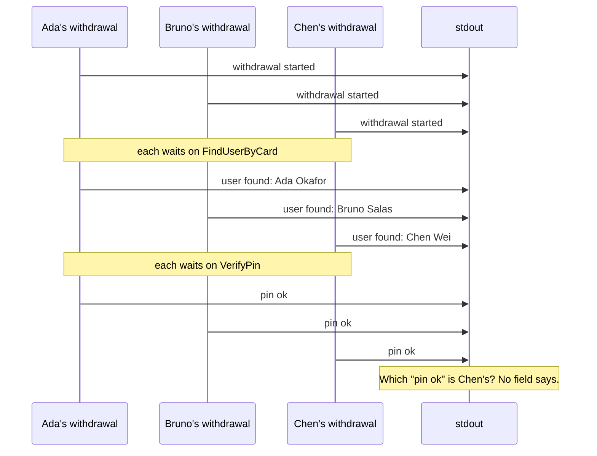

# Part 1: The Println wall

## The scene

It is 09:14 on a Saturday. A customer calls: the machine on Bridge Street took
eleven seconds to give them £40, and they want to know whether the money left
their account twice.

You have the logs. You wrote them.

```go
fmt.Println("withdrawal started")
fmt.Printf("user found: %s\n", user.Name)
fmt.Println("pin ok")
fmt.Printf("account found, balance %d\n", account.BalancePence)
fmt.Printf("debited, new balance %d\n", receipt.BalancePence)
fmt.Println("withdrawal complete")
```

Run the code you shipped:

```sh
go run ./workshop/01-the-console-log-wall/exercise
```

## Predict, before you run it

Write your answer down where you cannot edit later.

> Five withdrawals run at once. Looking only at that output, how would you find
> out how long Chen Wei's withdrawal took?

## What you get

```
withdrawal started
withdrawal started
withdrawal started
withdrawal started
withdrawal started
user found: Ada Okafor
user found: Bruno Salas
...
```

The names may come out in a different order on your machine. Each line describes
a withdrawal, and no field says which one.

The five calls share one process and one stdout. Each `withdraw` runs in its own
goroutine. While Ada's goroutine waits on the bank, the scheduler runs Bruno's.
The lines arrive in the order the steps finished, mixed across customers. Here
are three of the five:



In this run the steps take the same time, so the lines come out in batches. In
production a slow step reorders them, and the batches break apart.

A timestamp on each line records when a step finished. It cannot tell you which
withdrawal the step belonged to. You rarely notice this on your laptop, where one
request at a time owns the stream. Production runs many requests at once and
interleaves them.

The output lacks three things:

| Missing       | Why it hurts                                                          |
| ------------- | --------------------------------------------------------------------- |
| **Identity**  | No field ties a line to the withdrawal that wrote it                  |
| **Duration**  | You logged that a step happened, and never how long it took           |
| **Structure** | `"user found: Ada Okafor"` is prose, and you cannot filter on prose   |

To count Ada's withdrawals this morning, you would need a regular expression that
pulls her name out of `user found: Ada Okafor`. That expression breaks the day
someone rewords the message.

## Your turn

Open `exercise/main.go` and change the logging so you can answer the question
above. Do not reach for a logging or tracing package. Use `encoding/json`,
`math/rand/v2` and the rest of the standard library, and leave `log/slog` for part
6. You learn more by writing this by hand once.

You may change anything except the `bank` package.

## Our solution

```sh
go run ./workshop/01-the-console-log-wall/solution
```

```go
func logLine(withdrawalID, event string, fields map[string]any) {
	line := map[string]any{"t": time.Now().UnixMilli(), "withdrawal_id": withdrawalID, "event": event}
	maps.Copy(line, fields)
	// json.Marshal, then fmt.Println
}

withdrawalID := fmt.Sprintf("%08x", rand.Uint32())
startedAt := time.Now()
logLine(withdrawalID, "withdrawal.started", map[string]any{"amount_pence": amountPence})
// ...
logLine(withdrawalID, "withdrawal.completed", map[string]any{"duration_ms": time.Since(startedAt).Milliseconds()})
```

You made two changes. Each line carries an id, and each line is a JSON object
instead of a sentence. Save a run to a file, copy any `withdrawal_id` from it, and
search for that id. The ids are random, so a new run will not contain yours:

```sh
go run ./workshop/01-the-console-log-wall/solution > /tmp/part1.log
grep 9f2c41aa /tmp/part1.log   # use an id from your own file
```

You get one customer's withdrawal, and `duration_ms` answers the caller's question.

### Why this solution

Two definitions from _Observability Engineering_ (Chapter 5) name what you built.
An **event** is the record of one **unit of work**, here one withdrawal. A
**structured event** stores that record as named key-value pairs a program can
read, such as JSON. `fmt.Println("pin ok")` hands a tool one sentence. Your JSON
line hands it named fields, and a log tool can treat each key as a column, the way
a spreadsheet does. The book treats a structured log line and a structured event
as the same thing.

Columns change the question you can ask. To count Ada's withdrawals from the old
output, you pull her name out of prose with a regular expression. From the new
output you filter on a field, `user_id = 'u_001'`, and the filter survives a
reworded message.

The id changes the query too. The book describes the same move:

> Many developers stumble onto the same idea: give each request a unique ID and
> add it to each log line.

`WHERE withdrawal_id = '9f2c41aa'` now returns one customer's withdrawal. The book
offers a starting mental model for tracing that fits this: "a set of events that
all share the same ID." You have built the first piece of a trace.

### What it still does not do

A tool needs five fields on each record before it can draw a trace (Chapter 5).
Picture a restaurant order. The number on the ticket follows the order from till
to kitchen to table: that is the **trace ID**. Each station records its own step
with a step number (**span ID**), when it started, how long it took, and which
step it was part of (**parent ID**). Your solution has some of these fields:

| Field needed    | What it means                                  | Your part 1 solution                                |
| --------------- | ---------------------------------------------- | --------------------------------------------------- |
| **Trace ID**    | One id shared by all the records of a request  | `withdrawal_id`                                     |
| **Timestamp**   | When this piece of work began                  | `t`                                                 |
| **Duration**    | How long this piece of work took               | Only on `withdrawal.completed`, for the whole run   |
| **Span ID**     | An id for this one piece of work               | Missing                                             |
| **Parent ID**   | The id of the work this piece ran inside       | Missing                                             |

The gaps leave the customer's question open. If the Bridge Street machine takes
eleven seconds, `"duration_ms": 11004` confirms their story and tells you nothing
more. You cannot see which of the four steps took the time, and you cannot go back
for it, because the run has finished.

To fill the gaps you would time each step, give each step an id, and record which
step ran inside which. By then you have written a tracing library, and you own its
bugs. The solution prints four more gaps, including what happens when the debit
moves to another service. Part 11 answers that one.

Part 2 fills all five fields with one wrapper.

---

Next: [Part 2: Your first span](../02-your-first-span/README.md)
