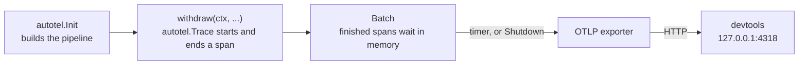
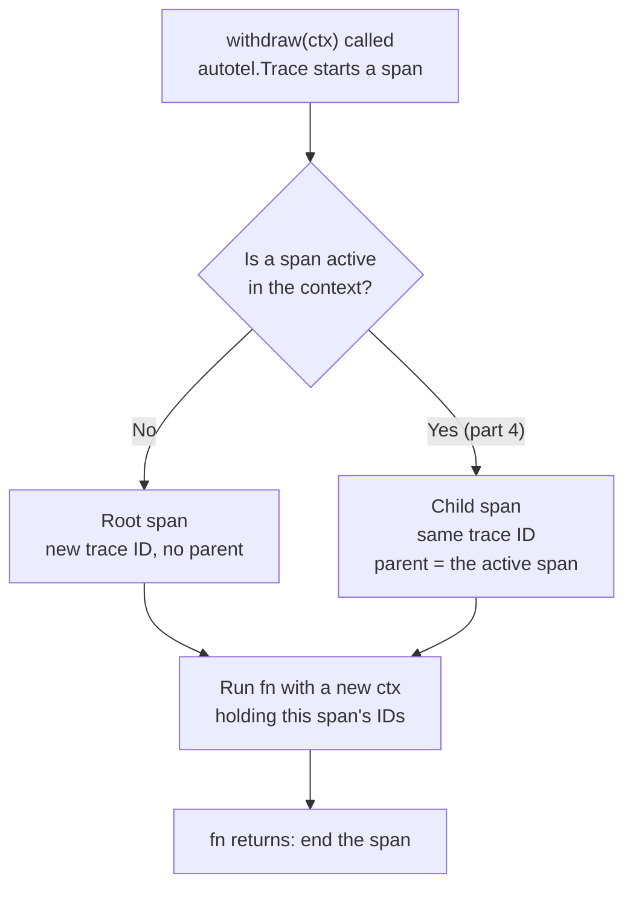
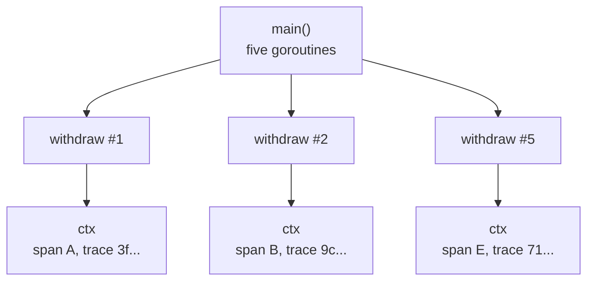

# Part 2: Your first span

## The scene

You shipped part 1's solution, and it helped. Then the Bridge Street machine went
slow again. You grepped one withdrawal out of the noise, and this was the whole
record of eleven seconds:

```json
{
  "withdrawal_id": "9f2c41aa",
  "event": "withdrawal.completed",
  "duration_ms": 11004
}
```

You need the same record with each step timed and nested inside the withdrawal,
and you would rather not write and maintain that code yourself.

## Setup, once for the whole workshop

Open a second terminal and leave it running:

```sh
npx autotel-devtools
```

The command starts a local receiver with a UI and prints a banner with its
address, normally `http://127.0.0.1:4318`. It needs Node 22 or newer; the
workshop's Go code does not. Open the address in a browser and leave the tab open.
For the next eleven parts you read that tab, in place of stdout, to see what your
code did. [Reading devtools](../README.md#reading-devtools) lists the controls you
will use. Click **Clear** before each run.

> If something else holds port 4318, devtools moves to the next free port and
> the banner shows it, such as `Listening: 127.0.0.1:4319`. Point your code at that
> port. Run this in the terminal where you run the Go code:
>
> ```sh
> export OTEL_EXPORTER_OTLP_ENDPOINT=http://127.0.0.1:4319
> ```

## Predict, before you run it

> `autotel.Trace` wraps a function. When five traced calls run at the same time
> in one process, how does the fifth call know it is not the first? No call is
> told about the others.

## Your turn

`exercise/main.go` holds part 1's solution, trimmed to its first and last lines.
You have three TODOs:

1. Call `autotel.Init` once, at the top of `main`, before any traced code runs.
2. Wrap the body of `withdraw` so each call becomes one span.
3. Make sure the spans leave the process before it exits.

The `autotel` package exports what you need. Try it before reading on.

```sh
go run ./workshop/02-your-first-span/exercise
```

## Our solution

```sh
go run ./workshop/02-your-first-span/solution
```

```go
func withdraw(ctx context.Context, cardNumber, pin string, amountPence int64) (bank.Receipt, error) {
	return autotel.Trace(ctx, "atm.withdraw", func(context.Context, autotel.Span) (bank.Receipt, error) {
		user, err := bank.FindUserByCard(cardNumber)
		if err != nil {
			return bank.Receipt{}, err
		}
		if _, err := bank.VerifyPin(cardNumber, pin); err != nil {
			return bank.Receipt{}, err
		}
		return bank.Debit(bank.GetAccount(user.ID), amountPence)
	})
}

func main() {
	ctx := context.Background()
	if _, err := autotel.Init(ctx, autotel.WithService("atm"), autotel.WithDevtools()); err != nil {
		log.Fatal(err)
	}
	defer func() {
		if err := autotel.Shutdown(ctx); err != nil {
			log.Print(err)
		}
	}()
	// ...the work. The deferred Shutdown sends the last batch.
}
```

Open the devtools tab. You will see five traces named `atm.withdraw` in the Traces
tab, each with its own duration. The random id, the `time.Since` arithmetic and
the `logLine` helper are gone, and you lost nothing with them.

The run also prints a line starting `INFO autotel: atm: exporting traces to`. That
line shows where your telemetry goes, which helps when a trace does not appear.

### Two words you now need

A **span** records one unit of work: a name, a start time, a duration, a status,
and any key-value fields you add. A **trace** is the set of spans one request
produced. The **root span** is the top one, the span with no parent. Each trace
here holds only its root span. In part 4 you add child spans underneath it.

A span is a structured log line with a few extra fields. Put your part 1 line next
to one:

| Span field         | What it holds                                                         | Part 1 equivalent               |
| ------------------ | --------------------------------------------------------------------- | ------------------------------- |
| **Trace ID**       | A random 32-character ID shared by all the spans in the trace         | `withdrawal_id`                 |
| **Span ID**        | A random 16-character ID for this span alone                          | none                            |
| **Parent span ID** | The span ID of the work this span ran inside. Empty on the root span. | none                            |
| **Start time**     | When the work began                                                   | `t`                             |
| **Duration**       | How long the work took                                                | `duration_ms`, whole run only   |
| **Name**           | What the work was, such as `atm.withdraw`                             | `event`                         |
| **Service name**   | Which deployable did the work, `atm` here                             | none                            |

The first five fields are the ones part 1 listed as the minimum a trace needs: the
order number and step stamps on the restaurant ticket. From them, devtools draws a
**waterfall**: one bar per span, placed at its start time, as long as its
duration, and indented under its parent.

_Observability Engineering_ (Chapter 5) sums up the mechanism:

> Let's peel back the layers to demystify tracing into a mental model that looks
> a lot like "fancy logs" combined with "context propagation" (in other words,
> "passing some IDs around").

The table above covers "fancy logs". The next section covers "passing some IDs
around".

**Name spans for the kind of work, and keep them groupable.** All your withdrawals
produce a span named `atm.withdraw`, so you can group them and compare. A name such
as `withdraw-u_007` would give each customer their own name and break that
grouping. The book's rule (Chapter 7): keep identifiers out of span names and put
them in attributes, which part 3 covers.

### Why this solution

**You call `autotel.Init` once per process, and it finishes its work before it
returns.** It sets up the pipeline, the path each span takes from your code to
devtools: where spans go, what the service is called, and which fields go on all
spans. Because it finishes before the next line runs, no span can start before the
pipeline exists. You can filter on `service = atm` in devtools, so name the service
after the deployable and leave the binary's file name out of it.

**`autotel.WithDevtools` configures the whole backend.** It tells the exporter to
send spans to `http://127.0.0.1:4318`, where `npx autotel-devtools` listens, and
keeps all your traces. An **exporter** is the component that sends finished spans
out of your process. It speaks **OTLP**, the OpenTelemetry Protocol: the standard
format for sending telemetry over the network, so any tool that accepts OTLP can
receive your spans. If you set `OTEL_EXPORTER_OTLP_ENDPOINT`, the exporter sends
there instead. Use `autotel.WithEndpoint` in place of `WithDevtools` and the same
code streams to Honeycomb, Grafana, Datadog or a **collector**, a relay service
that receives telemetry and forwards it on.

**`autotel.Trace(ctx, name, fn)` runs `fn` inside a new span and hands back its
result.** `fn` receives a new `context.Context` holding the span, and the span
itself. `autotel.Trace` starts the span, calls `fn`, ends the span when `fn`
returns, and returns what `fn` returned, so your error handling stays as it was.
It is generic over the result, and any error `fn` returns marks the span as failed.
Wrapping the whole body of `withdraw` makes each call one span. `withdraw` gains
one thing in its signature, a `ctx`, because Go carries the active span in a value
you pass.



**A library can call `autotel.Trace` safely before anyone calls `autotel.Init`.**
The work runs, the span goes nowhere, and `autotel.GetTraceID(ctx)` comes back
empty. OpenTelemetry splits the functions you call (the **API**, the
`go.opentelemetry.io/otel` module) from the machinery that records and sends (the
**SDK**, `go.opentelemetry.io/otel/sdk`), on purpose (Chapter 4). A library author
can instrument their code at no cost to an app that never plugs the machinery in.
`autotel.Init` plugs it in.

**You write these spans by hand, and that is one of two ways to get them.**
OpenTelemetry also has automatic instrumentation, which records HTTP clients,
servers and database drivers for you. In Go that means wrappers such as `otelhttp`
and `otelgrpc`, which autotel's `middleware` package builds on. Automatic
instrumentation cannot know that four calls add up to one withdrawal, or that a
refusal on the daily limit is a business outcome. The book advises using both
(Chapter 4): automatic for the plumbing, custom for the operations your business
cares about. This workshop writes the spans by hand so you see each mechanism once.

### Concurrent context

The word **context** means several things in observability, as the book points out
(Chapter 7). In this workshop it means one thing: the small record of which span
runs right now. For tracing it holds two values, the trace ID and the current span
ID. `autotel.Trace` reads it when a span starts:



That answers the prediction question. The fifth call does not need to know about
the other four. It reads the context, finds no active span, and starts a trace of
its own. So do the other four.

The context lives in a `context.Context`. Think of it as a name badge handed to
each withdrawal. `autotel.Trace` gives `fn` a new `ctx` wearing that span's badge,
so whatever you pass that `ctx` to reads Ada's badge and never Bruno's. A goroutine
has no identity of its own to hang a badge on, so Go has no ambient "current span".
The badge goes where you hand it. Five concurrent `withdraw` calls hold five
contexts, and each sees its own span.



Other languages move the same two IDs for you, in thread-local storage or attached
to a future. Go makes you pass them, which costs an argument and hides nothing.
This movement is called **propagation**. Moving the context between functions
inside one running program is intraprocess propagation, and passing `ctx` does it
here. Moving it between programs, say from the ATM to a separate auth service, is
interprocess propagation, which you do yourself in part 11.

### Where the badge falls off

The badge goes where `ctx` goes. Here are three ways to lose it, and none of them
warn you:

```go
autotel.Trace(ctx, "atm.withdraw", func(ctx context.Context, _ autotel.Span) (struct{}, error) {
	go sendReceipt(context.WithoutCancel(ctx)) // the badge goes with it
	go sendSMS(context.Background())           // a fresh ctx: no badge
	jobs <- writeAudit                         // a worker started at boot: its ctx, not this one
	return struct{}{}, nil
})
```

```
atm.withdraw   trace 930c3cbdf75c391305ba7944c38ee9ae
send_receipt   trace 930c3cbdf75c391305ba7944c38ee9ae
write_audit    trace ae688531e3ddbb8a34dd9aa27f40eb70
send_sms       trace 0bd5e96f5e36f7fccd2c83ad8c153bbe
```

The receipt joins the withdrawal's trace. `context.WithoutCancel` keeps the badge
and drops the cancellation, so the background work survives the request that
started it. The SMS and the audit write each start a trace of their own. You hit
the same problem inside a function when you shadow or discard the `ctx` that
`autotel.Trace` or `autotel.Start` gave you and carry on with the outer one: the
children attach to the wrong parent. To fix a queue, use the method from part 11:
put the context in the job itself, and restore it where the job runs.

### One thing to try before moving on

Delete the deferred `autotel.Shutdown`, click **Clear**, and run the solution
again. Nothing arrives. The exporter works like a post van. It collects finished
spans in a bag, the **batch**, and drives them to devtools every few seconds. A
long-running server sees the van come round many times. A short program exits
before the first round, and the bag is lost.

`autotel.Shutdown` **flushes** the batch: it sends the van out now with whatever is
waiting, then closes the exporter. `autotel.Init` also returns a cleanup function
that does the same and reports nothing, for when you want `defer cleanup()`. Keep
one of them on each exit path. `log.Fatal` and `os.Exit` end the process without
running deferred calls, so they lose the batch. `autotel.Flush` sends what is
waiting and keeps running.

If the flush finds no receiver, `autotel.Shutdown` returns an error, and the run
ends with `autotel: telemetry not delivered`, followed by the address it tried.
That message means devtools has stopped, or it runs on a port other than the one
the exporter targets.

---

Previous: [Part 1: The Println wall](../01-the-console-log-wall/README.md) ·
Next: [Part 3: Attributes, not messages](../03-attributes-not-messages/README.md)
