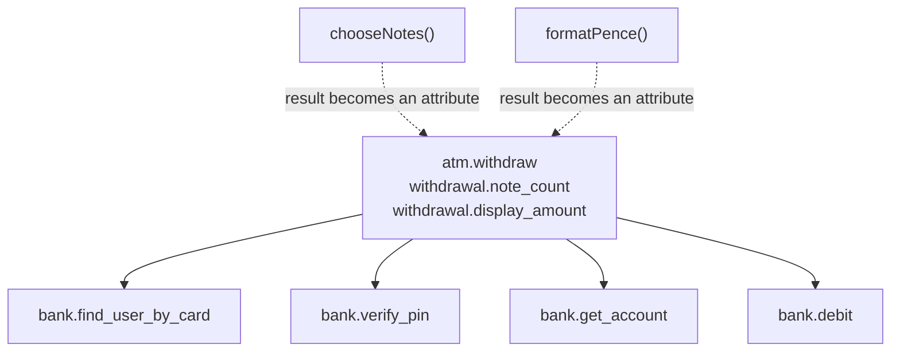

# Part 4: Which work deserves a span

## The scene

One withdrawal took about 355ms. Your trace holds one span, `atm.withdraw`, lasting
355ms. The customer already told you it was slow, so the trace adds nothing you did
not know.

Six operations run inside that withdrawal. You could give each one its own span, or
none of them. You need a rule for choosing.

```sh
go run ./workshop/04-which-work-deserves-a-span/exercise
```

## Predict, before you run it

For each of the six, answer yes or no before reading further:

| Operation                                                         | Span? |
| ----------------------------------------------------------------- | ----- |
| `VerifyPin`: checks the PIN, counts failures, can lock the card   |       |
| `FindUserByCard`: looks the customer up                           |       |
| `GetAccount`: looks the account up                                |       |
| `Debit`: moves the money                                          |       |
| `chooseNotes`: greedy arithmetic over four denominations          |       |
| `formatPence`: turns `4000` into `"£40.00"`                       |       |

## Your turn

Wrap the ones that earn it. `autotel.Trace(ctx, name, fn)` takes a function, and a
bank call fits inside one. You can instrument code you did not write without editing
it, right where you call it:

```go
receipt, err := autotel.Trace(ctx, "bank.debit", func(context.Context, autotel.Span) (bank.Receipt, error) {
	return bank.Debit(account, amountPence)
})
```

When `fn` returns an error, `autotel.Trace` marks the span's status as an error and
records an `exception` event carrying the error's message. Use it for `Debit`,
`VerifyPin` and `FindUserByCard`, which return an `error`. `GetAccount` cannot fail,
so use `autotel.TraceNoError` there.

The wrapped call produces a **child span**: a span whose parent is the span that was
active when it started, here `atm.withdraw`.

## Our solution

Click **Clear** in devtools, then run:

```sh
go run ./workshop/04-which-work-deserves-a-span/solution
```

The solution wraps four of the six:

```go
user, err := autotel.Trace(ctx, "bank.find_user_by_card", func(context.Context, autotel.Span) (bank.User, error) {
	return bank.FindUserByCard(cardNumber)
})
// and "bank.verify_pin" the same way
account := autotel.TraceNoError(ctx, "bank.get_account", func(context.Context, autotel.Span) bank.Account {
	return bank.GetAccount(user.ID)
})
receipt, err := autotel.Trace(ctx, "bank.debit", func(context.Context, autotel.Span) (bank.Receipt, error) {
	return bank.Debit(account, amountPence)
})
```

`chooseNotes` and `formatPence` get no span. Their results land on `atm.withdraw` as
attributes:



Click a trace row in devtools and you see the waterfall from part 2, with children
indented under their parent. To compare a typical withdrawal with the slow one, open
any trace, click **Back to traces**, then type `user.id = "u_007"` in the search box
and open that one:

```mermaid
gantt
  title Two withdrawals from the same run (ms)
  dateFormat x
  axisFormat %L
  section Typical
  bank.find_user_by_card :0, 16
  bank.verify_pin        :16, 22
  bank.get_account       :22, 33
  bank.debit             :33, 74
  section Slow
  bank.find_user_by_card :0, 16
  bank.verify_pin        :16, 22
  bank.get_account       :22, 33
  bank.debit             :crit, 33, 353
```



The slow withdrawal spends 320 of its 353ms inside `bank.debit`. With one span you
had a total. With five you can point at the step that took the time.

### Why this solution

_Observability Engineering_ (Chapter 7) gives two questions that guide the choice:

> 1. Is it "interesting"? Does the work meaningfully impact performance (e.g.,
>    latency or failures) for the overall request?
> 2. Is it "aggregable"? If you group this span by name and/or attributes, will
>    it produce useful trends and comparisons?

In plain terms: does this step change how long a withdrawal takes or whether it
succeeds? And would you compare this step across many withdrawals, such as the
average `bank.debit` time per branch? Run the six through them:

| Operation           | Interesting?                            | Aggregable?                            | Span    |
| ------------------- | --------------------------------------- | -------------------------------------- | ------- |
| `VerifyPin`         | Yes: can fail, and failure locks a card | Yes: group by outcome                  | **Yes** |
| `FindUserByCard`    | Yes: a lookup that can miss             | Yes: group by hit or miss              | **Yes** |
| `GetAccount`        | Yes: a lookup with variable latency     | Yes: group by account attributes       | **Yes** |
| `Debit`             | Yes: moves the money, and can be slow   | Yes: group by account, amount, outcome | **Yes** |
| `chooseNotes`       | No: sub-millisecond, deterministic      | No: nothing to group by                | No      |
| `formatPence`       | No: it is a `fmt.Sprintf` call          | No                                     | No      |

`atm.withdraw` passes for a different reason. The book separates orchestration code,
a function that calls other functions in order and takes as long as they do, from a
business transaction with an outcome of its own. The first earns no span; the second
does. A withdrawal ends dispensed or refused, and you will group by that outcome.

**Too many spans cost storage and attention.** A trace with a hundred two-millisecond
spans buries the boundaries you care about among implementation details:

> If your trace has a hundred two-millisecond spans, you probably have too many.
> Roll them up: combine them into a single span, or represent the details as an
> attribute.

To find which function inside a step burns the time, the book points you to a
profiler, a tool that samples which function the CPU is running. More spans will not
tell you.

The solution takes the second option for `chooseNotes` and `formatPence`. You keep
their results without timing them:

```go
autotel.SetAttributes(ctx, map[string]any{
	"withdrawal.note_count":     len(chooseNotes(amountPence)),
	"withdrawal.display_amount": formatPence(amountPence),
})
```

If a fact is worth recording and the work behind it is not worth timing, put the fact
on the span that already exists.

**Too few spans leave you with the 355ms you cannot explain**, the problem you
started this part with. You fix the two failure modes in opposite directions.

**A span explains one request; an attribute explains all of them.** The waterfall
shows where one withdrawal spent its time. Ask "which branch has the slowest debits?"
and you have to join two records: `atm.branch` lives on `atm.withdraw` and the
duration lives on `bank.debit`, so for each debit you look up its parent to find the
branch, then match the two. The book names wrapping everything in its own span as the
most common failure mode among engineers new to tracing (Chapter 6). Its fix is to
copy a few key timings, such as a `debit.duration_ms`, onto the parent as attributes,
so one record answers the question. Part 5 builds that parent record.

### Automatic nesting

You did not tell `bank.debit` that `atm.withdraw` is its parent. When a span starts,
it reads the active span from the `ctx` you gave it, the badge from part 2, and stores
that span's ID as its parent ID. Inside `atm.withdraw` you pass the `ctx` its function
received, so the bank spans wear the same badge. Pass the outer `ctx` by mistake and
they become siblings of `atm.withdraw`, with no error. Part 11 shows the same failure
across a network.

### Which functions to wrap in your own code

Wrap the places where your process hands work to something else and waits: an outgoing
HTTP call, a database query, a cache lookup, a queue publish or consume. Wrap each
incoming request handler too. Then add a span for the business operation that names
the request's purpose, such as `atm.withdraw` or `refund.issue`. You will group by
that name when someone asks how the product is doing.

In a real service, automatic instrumentation creates those spans for you: HTTP
clients, servers and database drivers wrapped with `otelhttp`, `otelgrpc` and their
relatives, as part 2 described. It errs toward too many. Review what it produces and
switch off the spans you do not query. Spend your own spans on the business operations
it cannot see.

Draw span boundaries around components and services, even where they cross team
ownership, as _Observability Engineering_ recommends. An incident follows the calls
your code makes, and those ignore your organisation chart.

---

Previous: [Part 3: Attributes, not messages](../03-attributes-not-messages/README.md) ·
Next: [Part 5: One wide event per request](../05-one-wide-event/README.md)
