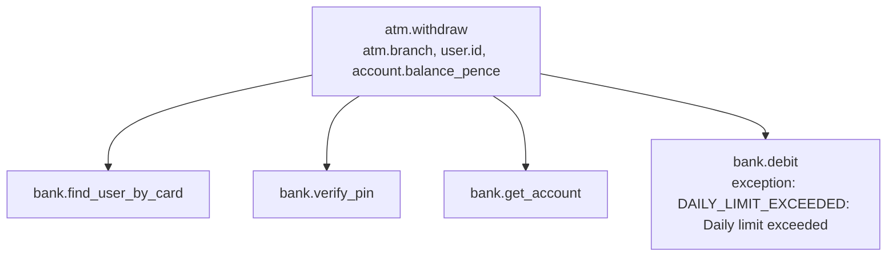
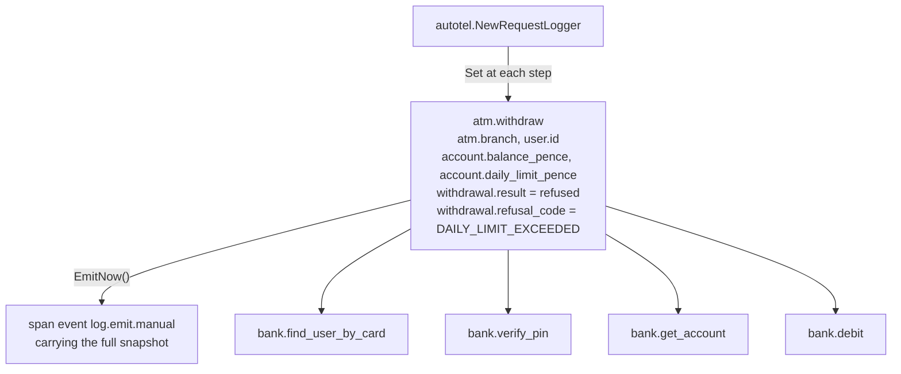
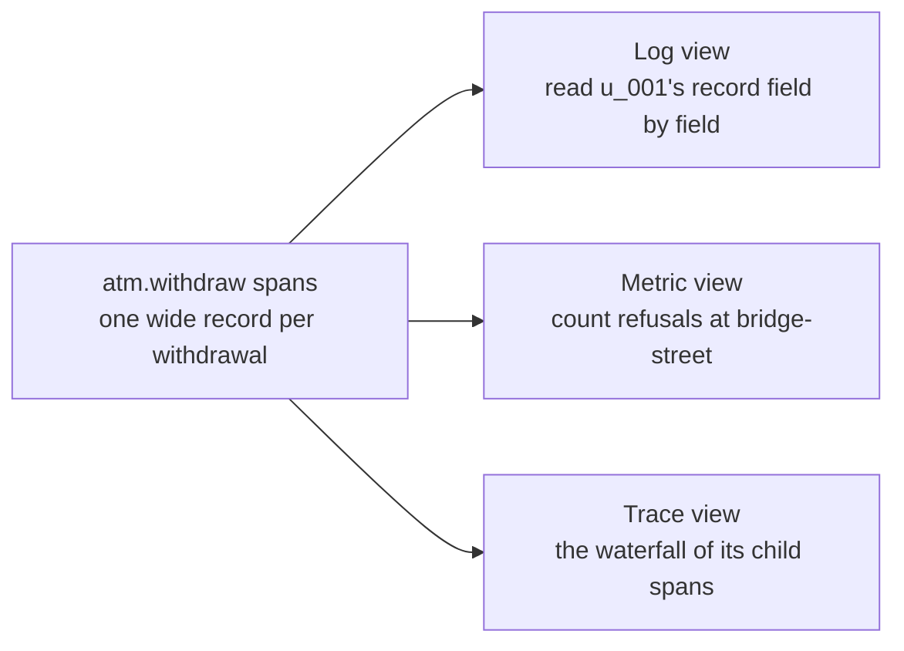

# Part 5: One wide event per request

## The scene

The machines refused two withdrawals this morning on the daily limit. Your manager
asks a reasonable question:

> Were those customers out of money, or did they have plenty and hit the £300
> cap?

You have the facts, scattered. The branch, the user and the balance sit on
`atm.withdraw` as separate attributes. The refusal code sits inside the `exception`
events your spans recorded, buried in the message
`DAILY_LIMIT_EXCEEDED: Daily limit exceeded`. No span carries the code as a field you
can filter on, and a successful withdrawal records no outcome at all. To answer, you
open each refused trace and read across its spans, one customer at a time.

```sh
go run ./workshop/05-one-wide-event/exercise
```

```
refused: u_001 DAILY_LIMIT_EXCEEDED
refused: u_004 DAILY_LIMIT_EXCEEDED
```

From this part on, the machines refuse some withdrawals. `atm.withdraw` already uses
`autotel.Trace`, so a refused withdrawal ends with its span marked as an error, the
same as part 4's `bank.debit`. Devtools shows those traces with an `ERROR` badge.

## Predict, before you run it

> The facts about a refused withdrawal already sit somewhere on its five spans. What
> do you gain by gathering them onto the root span as one record?

## Your turn

Gather what the withdrawal knew onto one record: who, where, how much, the balance,
the outcome, and the refusal code when there is one. Emit the record on the success
path and on the failure path, with the same field names on both.

`autotel.NewRequestLogger(ctx)` is the tool.

## Our solution

Click **Clear** in devtools, then run:

```sh
go run ./workshop/05-one-wide-event/solution
```

```go
return autotel.Trace(ctx, "atm.withdraw", func(ctx context.Context, _ autotel.Span) (receipt bank.Receipt, err error) {
	record := autotel.NewRequestLogger(ctx)
	record.Set(map[string]any{
		"atm":        map[string]any{"branch": branch},
		"withdrawal": map[string]any{"amount_pence": amountPence},
	})

	defer func() {
		var refusal *bank.Error
		if errors.As(err, &refusal) {
			record.Set(map[string]any{"withdrawal": map[string]any{
				"result":       "refused",
				"refusal_code": string(refusal.Code),
			}})
		} else {
			record.Set(map[string]any{"withdrawal": map[string]any{
				"result":         "dispensed",
				"transaction_id": receipt.TransactionID,
			}})
		}
		record.EmitNow()
	}()

	// ...
	record.Set(map[string]any{"user": map[string]any{"id": user.ID}})
	// ...
	record.Set(map[string]any{"account": map[string]any{
		"id":                    account.ID,
		"balance_pence":         account.BalancePence,
		"withdrawn_today_pence": account.WithdrawnTodayPence,
		"daily_limit_pence":     account.DailyLimitPence,
	}})

	return autotel.Trace(ctx, "bank.debit", /* ... */)
})
```

The manager's question becomes one filter:

```
withdrawal.refusal_code = "DAILY_LIMIT_EXCEEDED" and account.balance_pence > 40000
```

Both refused customers come back. Open each trace and click `atm.withdraw`: `u_001`
had £428.30 in the account and `u_004` had £794.79 when the machine refused them.
They had the money, and the £300 cap stopped them. You have a product decision to
revisit, and no outage.

In the exercise, each fact sits on whichever span learned it:



In the solution, the request logger gathers them onto the root span:



### Why this solution

**The request logger writes onto the root span.** The root span is the top span of
the trace, here `atm.withdraw`. `autotel.NewRequestLogger(ctx)` binds to the span in
`ctx`. Each `.Set` takes a map, merges it into what the logger already holds, and
flattens nested maps into dotted keys, so `{"account": {"balance_pence": ...}}`
becomes `account.balance_pence` and matches the naming from part 3. It writes those
keys onto `atm.withdraw` as attributes as soon as you call it. `.EmitNow()` seals the
logger. It adds one **span event**, a timestamped note pinned to a span, named
`log.emit.manual` and carrying the whole snapshot. The logger ignores any later `.Set`.

You get no sixth span. The root span becomes the **wide event**: one record per unit
of work, holding what that unit knew. Think of a till receipt. One slip lists the
shop, the time, each item and the total, so you can answer any question about the
purchase from that slip. The exercise gave you five sticky notes, one fact on each,
and you had to find them and line them up first.

Written out as data, the root span of `u_001`'s refused withdrawal holds:

```json
{
  "name": "atm.withdraw",
  "service.name": "atm",
  "atm.branch": "bridge-street",
  "user.id": "u_001",
  "withdrawal.amount_pence": 25000,
  "account.id": "acc_001",
  "account.balance_pence": 42830,
  "account.withdrawn_today_pence": 10000,
  "account.daily_limit_pence": 30000,
  "withdrawal.result": "refused",
  "withdrawal.refusal_code": "DAILY_LIMIT_EXCEEDED"
}
```

That answers the prediction. The refusal code moves out of an exception message and
into a field on the root span, next to the branch and the balance. One filter can now
combine facts that used to live apart, because devtools matches all the conditions in
a query against one span. Each field is flat, so the record reads like one row of the
spreadsheet from part 3, with more columns.

**Use `defer` to cover both outcomes.** The function has four `return` statements,
and a line before each one is a line someone forgets. Named results let a deferred
function read the values being returned: `err` holds the refusal and `receipt` the
money moved, whichever `return` ran. The deferred function records the outcome,
`EmitNow` writes the event, and the error goes back to the caller unchanged, so
`autotel.Trace` still marks a refusal as an error. Both paths emit the same field
names. Teams that emit a different shape on the error path can count their successes
and cannot count their failures.

Mind the shadowing. `if _, err := ...; err != nil { return bank.Receipt{}, err }`
declares a new `err`, and `return` still assigns it to the named result, so the
deferred function sees it. A bare `return` inside that block would not compile, so
the compiler catches the trap for you.

`errors.As` finds the `*bank.Error` in the chain. Go's type system does not promise
that a given `error` here is one, so the `else` branch would call a surprise failure
`dispensed`. Part 7 returns to failures with no code.

**This shape has a name: the canonical log line.** A **canonical log line** is one
wide, structured event per unit of work, written once at the end. The book stores all
telemetry this way. "Three pillars" in its quotes means keeping logs, metrics and
traces in three separate tools, the model it argues against (Chapter 1):

> All the telemetry that describes a request is stored once, preserving as much
> context and many relationships as possible, either in arbitrarily wide,
> structured log events, called "canonical logs," or as spans and traces.

Part 3 defined cardinality, how many answers one field has. The argument for wide
events turns on **dimensionality**, how many fields one record carries. A question
looks at some fields together. Take four fields from the withdrawal: branch, user,
balance and refusal code. You can ask about one field alone (4 ways), a pair such as
branch with refusal code (6 ways), any three (4 ways) or all four (1 way): 15
questions. There is a shortcut. Each field is either in your question or out of it,
which gives 2 × 2 × 2 × 2 = 16 choices, minus the empty one. Each new field doubles
the count, and the book's numbers climb fast (Chapter 1):

> If a structured log has four dimensions or attributes, you can combine them in
> 15 possible ways. The math escalates quickly:
>
> 4 fields → 6 pairwise combos, 15 possible combinations
> 8 fields → 28 pairwise combos, 255 possible combinations
> 30 fields → 435 pairwise combos, 1.1 billion possible combinations
>
> This is why the three pillars model is so costly. When you scatter signals
> across siloed tools by type, you don't just lose some of the value; you lose
> most of it.

Now split thirty fields across five spans, six on each. Each span supports
2⁶ − 1 = 63 combinations, 315 across the five, where one record with all thirty
supports about a billion. You keep all the fields and lose the questions that need
two fields from different spans, such as refusal code with balance.

Your manager's question combines two fields: refusal code and balance. You did not
write that query in advance, because you did not know anyone would ask it. Test your
instrumentation against the questions you expect, then add context as investigations
reveal gaps.

### One record, many views

Logs, metrics and traces look like three kinds of data. Chapter 5 of the book takes
them apart and finds one shape underneath: a structured event, a set of key-value
pairs describing a unit of work. The wide `atm.withdraw` span has that shape, so you
can read it three ways:



The metric view changes how you work. A metrics system makes you choose the aggregate
before you collect anything. With wide events you choose it afterwards: type
`withdrawal.result = "refused" and atm.branch = "bridge-street"` into the search box,
read the count in the heading, and you have a refusal count for that branch that
nobody defined in advance. The book's phrase is to capture the facts and "post-decide
the necessary shape" (Chapter 5).

### What else belongs on the wide event

The solution's record holds about ten fields. The book's contributor finds hundreds on
a well-instrumented service (Chapter 6). Two additions pay off early:

- **Timings of key steps.** A `debit.duration_ms` field on the root lets you ask which
  branch has the slowest debits without joining two spans, the problem part 4 left
  open.
- **Deploy and runtime context.** `service.version` and any feature flag the request
  touched let you compare one release, or one flag value, against another.

Count on the root span only. A child span can carry a field with the same name, and a
query over all spans would count it twice. The book tags wide events with `main = true`
for this reason. Here the root span's name, `atm.withdraw`, does the same job.

### When to use which

You now have three complementary ways to record a fact:

|                                                    | Reach for it when                                                                   |
| -------------------------------------------------- | ----------------------------------------------------------------------------------- |
| **Span** (`autotel.Trace`, `autotel.TraceNoError`) | Work that takes time and can fail. It answers _how long_ and _what ran inside what_ |
| **Attribute** (`autotel.SetAttribute`)             | A fact about one piece of that work                                                 |
| **Request logger** (`autotel.NewRequestLogger`)    | Everything the whole unit of work knew, gathered onto the root span as one record   |

Treat the request logger as a discipline: gather as you go, emit once, and keep the
same shape on each path.

**Keep secrets out of it.** You want to hand a wide event to anyone debugging, so leave
out PINs, card numbers, tokens and full names. `autotel.WithPIIRedaction()` gives you
a backstop: it scrubs attribute values that look like personal data before they leave
the process. Data you do not record cannot leak through telemetry.

---

Previous: [Part 4: Which work deserves a span](../04-which-work-deserves-a-span/README.md) ·
Next: [Part 6: Logs you already have](../06-logs-you-already-have/README.md)
