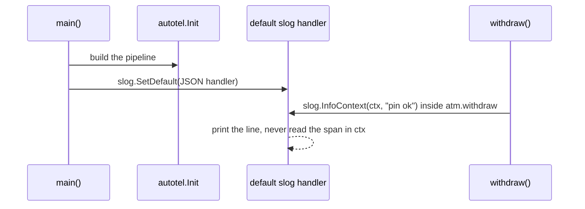
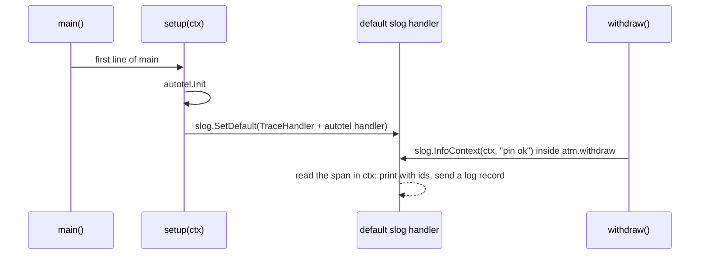

# Part 6: Logs you already have

## The scene

Part 5 gave each withdrawal one wide record, and your team likes it. Then someone
points at the rest of the codebase: four hundred `slog.InfoContext` calls, written over
three years, feeding a log search the support team uses daily.

You will not delete them. You want each of those lines to say which withdrawal wrote
it, so a support agent who finds `pin ok` in the log search can jump to that
withdrawal's trace.

Part 1 left you in the same place with `fmt.Println`: five withdrawals writing into one
stream, and no field saying whose line is whose.

```sh
go run ./workshop/06-logs-you-already-have/exercise
```

## Predict, before you run it

> The exercise calls `autotel.Init` on the first line of `main`, before any withdrawal
> runs, and it traces all of them. The log lines still carry no trace id. What did
> `autotel.Init` fail to reach?

## Your turn

Make each log line carry the `trace_id` and `span_id` of the withdrawal that wrote it.
Do not add either field by hand: the logger calls stay as they are.

Two hints. The `logging` package exports `NewTraceHandler`, `autotel.Logger(name)`
returns a logger whose `Handler()` sends records over OTLP, and `log/slog` has
`NewMultiHandler`. And a `package main` directory can hold more than one file: `go run`
builds them all.

## What you get

```
{"time":"2026-11-04T20:21:24.360064Z","level":"INFO","msg":"withdrawal started","amount_pence":8000}
{"time":"2026-11-04T20:21:24.360101Z","level":"INFO","msg":"withdrawal started","amount_pence":2000}
{"time":"2026-11-04T20:21:24.360118Z","level":"INFO","msg":"withdrawal started","amount_pence":6000}
```

The structure from part 1 is there: JSON, named fields. The identity is missing. Five
withdrawals still share one stream, and no field ties a line to the trace you built in
parts 2 to 5.

## Our solution

Click **Clear** in devtools, then run:

```sh
go run ./workshop/06-logs-you-already-have/solution
```

Move the setup into its own file:

```go
// instrumentation.go
func setup(ctx context.Context) error {
	// 1. The pipeline: where spans, and now log records, go.
	if _, err := autotel.Init(ctx, autotel.WithService("atm"), autotel.WithDevtools()); err != nil {
		return err
	}

	// 2. One logger, two destinations.
	slog.SetDefault(slog.New(slog.NewMultiHandler(
		logging.NewTraceHandler(slog.NewJSONHandler(os.Stdout, nil)),
		autotel.Logger("atm").Handler(),
	)))

	return nil
}
```

Then make it the first thing `main` does, in place of both the `autotel.Init` call and
the old logger setup:

```go
func main() {
	ctx := context.Background()
	if err := setup(ctx); err != nil {
		log.Fatal(err)
	}
	// ...the withdrawals, unchanged
}
```

The logger calls in `solution/main.go` did not change, and each line now carries three
new fields:

```
{"time":"2026-11-04T20:21:25.491302Z","level":"INFO","msg":"withdrawal started","amount_pence":2000,"trace_id":"7d2db23e7050851ce1e0e880ec77ba76","span_id":"f38df12c73b7de26","trace_flags":"01"}
```

Your ids will differ. Copy one `trace_id` from your output and search for it in
devtools:

```
trace_id = "7d2db23e7050851ce1e0e880ec77ba76"
```

The list narrows to one trace. Click its row, and the **Logs** section under the
waterfall lists that withdrawal's four log lines in order. The **Logs** tab in the
sidebar shows all 20 lines from the run and takes queries of its own, such as
`body = "pin ok"`.

### Why this solution

**A log line reaches the outside world through a handler.** `slog.InfoContext` writes
nothing itself. It builds a record and hands it, with `ctx`, to the default logger's
`slog.Handler`, and the handler decides the next step: print it, send it somewhere,
drop it. The exercise's handler was a JSON printer that knows nothing of OpenTelemetry,
so nothing on the way out read the span in `ctx`.

**`autotel.Init` builds a pipeline and touches nothing else.** It sets up where spans,
metrics and log records go. It leaves your logger alone. In the exercise, `autotel.Init`
ran first and the withdrawals were traced, yet the handler that printed each line had
nothing from autotel in it:



**The ids ride in `ctx`, so the call has to pass it.** This trap is quieter than a
missing handler. `slog.Info("pin ok")` and `slog.InfoContext(ctx, "pin ok")` print the
same line, and only the second gives a handler a span to read. The first compiles, runs
and loses its ids. A log line deep in a helper that received no `ctx` has the same
problem, part 2's lost badge. The `sloglint` linter can ban the context-free calls.

**`slog.SetDefault` replaces the whole logger.** You can call it as often as you like,
so a library or a later setup step can swap your handler out, and the last caller wins.
`setup` holds the order in one place, and `main` calls it before anything else:



**You will meet this as a "nothing shows up" bug at work.** A service creates its logger
in `main` with `slog.New(...)`, passes it around as a dependency, and has `autotel.Init`
added above it. You get your spans from `autotel.Trace` and no correlated logs, with no
error to say so. The cure: one setup function that builds the pipeline and the logger,
called on the first line of `main`.

### Two things the handlers do

1. **`logging.NewTraceHandler` stamps the ids into each line.** It wraps the handler you
   already have, which prints the same facts as before and adds `trace_id`, `span_id`
   and `trace_flags` whenever `ctx` holds a recording span. Your log search, whichever
   you use, now has a `trace_id` field on each line. People call this _log correlation_:
   you can match logs and traces by id.
2. **`autotel.Logger(name).Handler()` sends each line to devtools as a log record.**
   OpenTelemetry carries three kinds of data, called _signals_: traces, metrics and logs.
   You have used traces since part 2, and part 9 covers metrics. This handler turns each
   record into an OpenTelemetry log record, with its trace id, and the exporter sends it
   alongside your spans.

`slog.NewMultiHandler` gives a record to both, and they are separate, so you can keep one
without the other: a service whose log search already works might only stamp the ids, and
one with no log search at all might only send the records. If `autotel.Init` built no log
pipeline, because no endpoint is set, an `autotel.Logger` prints to stderr and keeps the
line.

The book describes where this leads. In Chapter 5, the authors picture a set of events
that all share the same ID, which is what a trace is. With the id on each line, your logs
join that set, and you stop treating them as a separate pile.

### Where log lines fit next to the wide event

You now have two kinds of record per withdrawal, joined by `trace_id`:

| Record                | How many per withdrawal | Good for                                                      |
| --------------------- | ----------------------- | ------------------------------------------------------------- |
| Wide event (part 5)   | One                     | Filtering: "refused at bridge-street, over £400"              |
| Log lines (this part) | One per step            | Reading the story of one withdrawal in order                  |

Keep writing log lines for the steps a person reads while debugging. Put the facts you
will filter or group on into the wide event, so you can answer a question without
searching free text. The trace id lets you move between the two.

### Using the `log` package or zap instead

Plenty of older code logs through the standard `log` package. `slog.SetDefault` also
routes `log.Print` through your handler, so those lines reach both destinations. `log.Print`
takes no `ctx`, so they arrive without ids. If your team uses zap, `logging.TraceFields(ctx)`
returns the same ids as zap fields.

---

Previous: [Part 5: One wide event per request](../05-one-wide-event/README.md) ·
Next: [Part 7: Errors that explain themselves](../07-errors-that-explain-themselves/README.md)
