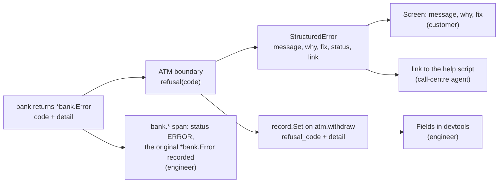
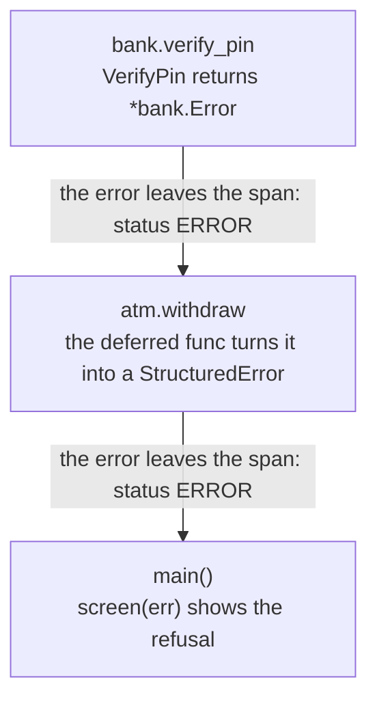
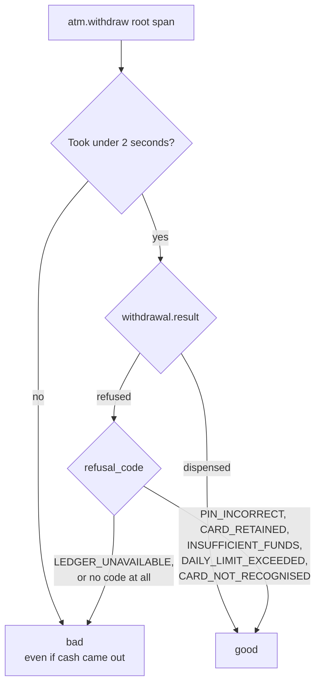

# Part 7: Errors that explain themselves

## The scene

Last month the call centre took 400 calls that all began the same way:

> The machine said "Transaction failed, contact your bank." What does that mean?

That one sentence hides five conditions: an unrecognised card, a wrong PIN, a retained
card, an empty account, and a daily cap that resets at midnight. If the machine named
the condition, customers could sort out four of them without picking up the phone.

```sh
go run ./workshop/07-errors-that-explain-themselves/exercise
```

The exercise runs six withdrawals. One uses an unknown card. Three use the same card
with the wrong PIN. One asks for more than the balance, and one asks for £400 against a
£300 daily limit. All six end on the same screen:

```
── a third wrong PIN, and the machine keeps the card ──
┌──────────────────────────────────────┐
│ Transaction failed.                  │
│ Contact your bank.                   │
└──────────────────────────────────────┘
  (returned: CARD_RETAINED: Card retained)
```

## Predict, before you run it

> Three audiences need to understand the refusal: the customer at the machine, the agent
> taking the call, and the engineer on call at 3am. Does that take three error types, or
> one?

## Your turn

Make each refusal say what happened, why, and what to do next. You have two constraints:

- The screen sits in a public place. Nothing on it may help someone standing behind the
  customer.
- The engineer on call needs more than the screen shows, and should not have to read this
  file to get it.

`autotel.StructuredError` is the tool. A **structured error** is an error that carries
named fields (`Why`, `Fix`, `Status`, `Link`) next to its message, so code can read each
part on its own. It implements `error`, so it returns and wraps like any other, and
`autotel.ParseError(err)` reads those fields back out of any error.

## Our solution

Click **Clear** in devtools, then run:

```sh
go run ./workshop/07-errors-that-explain-themselves/solution
```

The solution has three pieces: a table, a translation, and a reader.



**The table.** `refusal()` holds one case per `bank.Code`. The run produces five of the
six codes. `bank` does not return `LEDGER_UNAVAILABLE` yet, and that code shares the
`default` case, because Go's `switch` is not exhaustive: the day someone adds a seventh
code, it lands there and the customer sees "cannot reach your bank". The `exhaustive`
linter turns that into a build failure if you would rather write the words first.

```go
case bank.DailyLimitExceeded:
	refused.Message = "Daily limit reached"
	refused.Why = "This amount would take today’s total past the £300 daily cash limit."
	refused.Fix = "The limit resets at midnight. Larger amounts can be arranged in branch."
	refused.Status = 429
	refused.Link = "https://bank.example/help/daily-limit"
```

**The translation** happens in one place, at the boundary. It sits in the deferred
function from part 5, and it assigns to the named result, so the caller gets the
structured error whichever `return` ran:

```go
defer func() {
	var refused *bank.Error
	if errors.As(err, &refused) {
		record.Set(map[string]any{"withdrawal": map[string]any{
			"result":       "refused",
			"refusal_code": string(refused.Code),
		}})
		// The domain's own detail (attempts remaining, limits) is safe to keep
		// in telemetry and is what the on-call engineer wants.
		record.Set(refused.Detail)
		err = refusal(refused.Code)
	}
	record.EmitNow()
}()
```

**The reader** is the code any client would write. You parse nothing by hand:
`autotel.ParseError` reads the typed fields.

```go
if _, err := withdraw(ctx, cardNumber, pin, amount); err != nil {
	screen(err) // parsed.Message, parsed.Why, parsed.Fix, parsed.Status, parsed.Link
}
```

The screen for the daily-limit refusal:

```
── over the daily limit ──
┌──────────────────────────────────────────────────────────┐
│ Daily limit reached                                      │
├──────────────────────────────────────────────────────────┤
│ This amount would take today’s total past the £300 daily │
│ The limit resets at midnight. Larger amounts can be arra │
└──────────────────────────────────────────────────────────┘
  status 429  ·  https://bank.example/help/daily-limit
```

### Why this solution

**One error type can serve three audiences.** Each field has a reader:

| Field     | Read by                                                                   |
| --------- | ------------------------------------------------------------------------- |
| `Message` | The customer. One line, on a screen, in public                            |
| `Why`     | The customer and the agent. What the machine believes happened            |
| `Fix`     | The customer. The next step they can take themselves                      |
| `Status`  | The caller's code. `402` and `429` take different branches; both "failed" |
| `Link`    | The agent. The page with the script for this refusal                      |

The engineer's facts stay off the error. `StructuredError` has a `Cause` field, and the
solution leaves it empty on purpose: `MarshalJSON` writes the cause's message, so a cause
set here would reach any client you serialised the error to. The engineer reads the trace
instead. `autotel.Trace` records each error that leaves a span, so the `bank.verify_pin`
span carries the original error, `CARD_RETAINED: Card retained`, with its code intact.
`atm.withdraw` carries the code and the domain's detail as fields. Because it records a
`StructuredError`, it also gains `error.code`, `error.status`, `error.why`, `error.fix` and
`error.link` with no code from you. The error that reaches the screen holds only what the
screen may show.

The status codes borrow HTTP meanings so a caller can branch on a number it already
understands. `402 Payment Required` marks insufficient funds. `423 Locked` marks a retained
card. `429 Too Many Requests` marks the daily limit, because the customer has asked for too
much today. `503` marks a ledger that did not answer, the one refusal caused by the bank's
own systems.

**You put the translation at the boundary.** `bank` still returns its own `*bank.Error` and
knows nothing of screens, call centres or help pages. The ATM knows all three, so the
mapping lives in the ATM, in one table a product manager can read and edit.

**The screen and the telemetry get different facts.** The screen hides the balance, the PIN
attempts left and the card that went in. The span holds the attempts and limits, because
`record.Set(refused.Detail)` copies the domain's own numbers onto it. The third wrong PIN
and the daily-limit refusal leave these fields:

```
auth.attempts = 3
auth.attempts_remaining = 0
account.daily_limit_pence = 30000
account.withdrawn_today_pence = 0
```

The daily-limit customer had withdrawn nothing today, so the £400 request broke the limit
on its own. You learn that from the fields, with no phone call.

**Keep secrets out of telemetry.** Attempt counts and limits help an investigation. PINs,
full card numbers and names stay out of your fields. `Detail` is the bank's own list of
facts it considers safe to record, so the ATM copies it whole and adds nothing from the
request.

### Refusals and the ERROR status

Each span carries a **status**: `UNSET` by default, `OK`, or `ERROR`. Tracing tools count
`ERROR` spans to draw an error-rate chart and to fire **alerts**: automatic messages that
tell a person something is wrong. An urgent alert **pages** someone, which means it rings
their phone, day or night. The person holding that phone this week is **on call**.

`autotel.Trace` sets `ERROR` on a span when the function it wraps returns an error. It also
records the error's message on the span, so you do not call `RecordError` yourself. In this
part that rule fires on each refusal, twice:



You should make that trade-off on purpose. A wrong PIN or a daily limit is an expected
business outcome: the system did its job and said no. HTTP draws the same line with its
status codes. A `4xx` code means the caller got something wrong, such as a mistyped URL. A
`5xx` code means the server broke. OpenTelemetry marks a server span `ERROR` only for `5xx`.
If you build an error-rate alert on `status = ERROR` against this code, your on-call engineer
gets woken up when a customer mistypes a PIN.

A count of `ERROR` spans has a second problem. The diagram shows one refusal marking two
spans, so a raw count reports two errors for one withdrawal. Chapter 6 of _Observability
Engineering_ computes error rates over the root span of each request only, for the same
reason. Here that means `atm.withdraw`.

### Which refusals deserve a page

Chapter 11 sets two tests for an alert worth waking someone for. It must be a reliable sign
that users are having a worse time, and the person woken must be able to do something about
it. A wrong PIN fails the first test. The customer got a correct answer in about 20ms, and
no engineer can fix their memory.

The book's tool for this is the **service level objective** (SLO). You can build one in four
steps.

**1. Decide what a good withdrawal is,** in words a customer would agree with: "the customer
got a correct answer within two seconds". A refusal for a wrong PIN is a correct answer. A
ledger that never replied is not.

**2. Turn that sentence into a rule.** The rule is the **service level indicator** (SLI). It
looks at each `atm.withdraw` span and gives a verdict:



The slow branch counts. The Bridge Street customer from part 1 got their £40 after eleven
seconds, and the SLI still marks that withdrawal as bad. Chapter 11 makes the same call for a
web page: a response over the time limit counts as an error even when it returned a success
code.

**3. Count, and pick a target.** Over the last 30 days, divide good withdrawals by all
withdrawals. If the estate handled 300,000 and 299,700 were good, you scored 99.9%. The SLO
is the score you promise to stay above, say 99.9%.

**4. Treat the gap as a budget.** A 99.9% target over 300,000 withdrawals allows 300 bad ones
a month. That allowance is the **error budget**. Think of a phone plan with 30 GB of data a
month: using it is fine, and you only have a problem if it runs out before the month ends.

The alert watches the **burn rate**: how fast you spend the budget compared with the steady
pace that would last the full 30 days. Here the steady pace is 10 bad withdrawals a day.
Chapter 12 describes a ladder of responses:

- **About 1x,** spending at the steady pace: nothing to do.
- **About 2x for a sustained stretch,** or a slow leak that puts you on course for 99.88% by
  the end of the month: an alert that waits for working hours.
- **Four times the pace or faster:** a page, now.

Five wrong PINs cost nothing, because they count as good. Now take a ledger outage. The estate
handles about 830 withdrawals every two hours, and the outage fails 200 of them. That spends
two thirds of the month's budget in two hours, 240 times the steady pace, since the steady
pace allows under one bad withdrawal in that time. That pages someone, because customers felt
it and an engineer can act on it.

The SLO tells you _what_ is wrong, customers getting bad answers, and says nothing about _why_.
Chapter 11 considers that a strength. Older alerts watch a possible cause, such as "CPU above
80% for five minutes", and fire whether or not a customer noticed. Teams learn to ignore alerts
that cry wolf, which the book calls **alert fatigue**. An SLO alert fires on the symptom
customers feel, and the investigation in part 10 finds the cause.

### Expected errors and unexpected ones

Chapter 6 suggests two error fields. An `exception.expected` flag separates failures you cannot
prevent (a wrong PIN) from real faults. An `exception.slug` gives each place that fails a short
fixed label you can group by and search the code for. `withdrawal.refusal_code` already does the
slug's job: `DAILY_LIMIT_EXCEEDED` names one return site in `bank/ledger.go`. An `expected` column
in `refusal()` would add the flag: true for five codes, false for `LEDGER_UNAVAILABLE`.

The book adds one query worth running: failures with no label. Here that means an `atm.withdraw`
span with status `ERROR` and no `withdrawal.refusal_code`:

```
name = "atm.withdraw" and status = ERROR and withdrawal.refusal_code = NULL
```

`= NULL` matches a span that lacks the field. Keep the `name` condition: the `bank.*` spans have
status `ERROR` and no refusal code, so without it all six traces come back.

In this code the query returns nothing, because each failing call returns a `*bank.Error`. Go will
not hold you to that: `error` is an interface, so a timeout added to `Debit` next month compiles,
skips the `errors.As` branch and reaches the customer as a raw message. The query catches that. A
panic, such as `GetAccount` finding no account, is the other way out: it takes the goroutine and
the process down and returns no refusal.

To keep refusals out of the span error rate, return the refusal as a value from the function you
give `autotel.Trace`, in place of an `error`. The span then keeps status `UNSET`, and you record
real faults yourself with `autotel.RecordError`. This workshop keeps the error return so you can
see the wrapper's behaviour.

### Try it

Run these in the search box:

```
withdrawal.result = "refused"
status = ERROR
withdrawal.refusal_code = "CARD_RETAINED"
```

The first two each return all six withdrawals. The last returns one, and it is worth a moment.
Open it and click `atm.withdraw`. Three withdrawals used one card with the same wrong PIN, and the
third ended differently from the first two. The counter behind that lives in `bank/auth.go` and
survives between requests. State that outlives a request makes an incident confusing, and
`auth.attempts = 3` on the span tells you the earlier requests happened.

---

Previous: [Part 6: Logs you already have](../06-logs-you-already-have/README.md) ·
Next: [Part 8: The questions the business asks](../08-events-the-business-asks-for/README.md)
