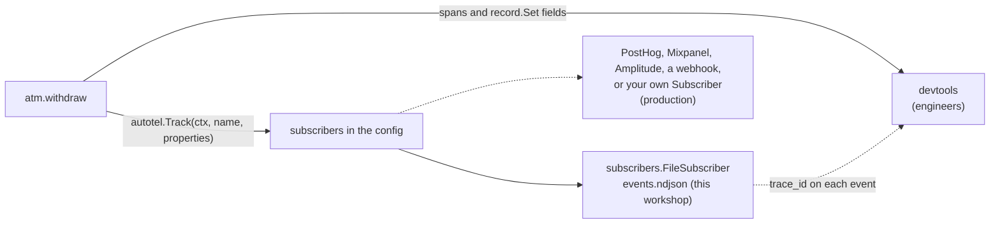
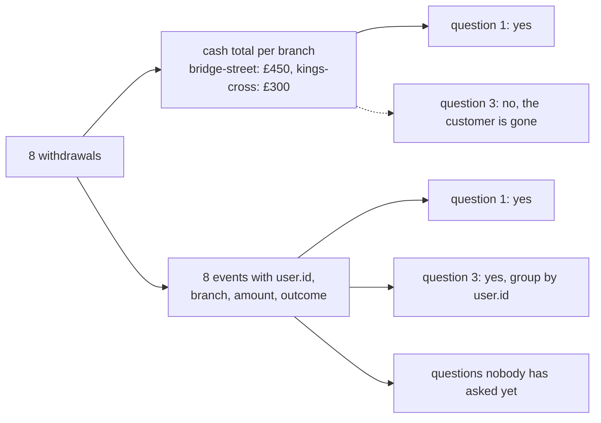

# Part 8: The questions the business asks

## The scene

Three questions arrived this week, and no engineer asked any of them.

1. How much cash left the estate at bridge-street yesterday?
2. Of the customers we refused on the daily limit, how many had enough money?
3. When we refuse someone, do they come back and try a smaller amount?

Part 5 answered question 2 with one filter. Questions 1 and 3 are about what customers
did. The product team asks them weekly, and they should not need a login to your tracing
tool to get an answer.

```sh
go run ./workshop/08-events-the-business-asks-for/exercise
```

The exercise runs six withdrawals of £100, alternating bridge-street and kings-cross. Then
customer `u_001` comes back to bridge-street, asks for £250, gets refused on the daily
limit, and asks again for £150.

## Predict, before you run it

> Your spans already contain the amount, the branch and the outcome of each withdrawal.
> So what is left for a separate event to do?

## Your turn

Emit a business event for each completed and each refused withdrawal, and send it somewhere
a product team could read without asking you.

A **business event** records something that happened in the world ("cash withdrawn",
"withdrawal refused") in the terms a product team uses. `autotel.Track` emits one. A
**subscriber** is a destination for those events: a file, a webhook, or an analytics tool
such as Mixpanel. You pass subscribers to `autotel.Init` with `autotel.WithSubscribers`, and
each `autotel.Track` call goes to all of them. The `subscribers` package holds the ones that
ship with autotel.

## Our solution

Click **Clear** in devtools, then run:

```sh
go run ./workshop/08-events-the-business-asks-for/solution
```

```go
file, err := subscribers.NewFileSubscriber(eventsFile)
// ...
autotel.Init(ctx, autotel.WithService("atm"), autotel.WithDevtools(), autotel.WithSubscribers(file))

autotel.Track(ctx, "atm.cash_withdrawn", map[string]any{
	"user.id":                     user.ID,
	"atm.branch":                  branch,
	"withdrawal.amount_pence":     amountPence,
	"account.balance_after_pence": receipt.BalancePence,
})

properties := map[string]any{
	"atm.branch":              branch,
	"withdrawal.amount_pence": amountPence,
	"withdrawal.refusal_code": code,
}
if userID != "" {
	properties["user.id"] = userID
}
autotel.Track(ctx, "atm.withdrawal_refused", properties)
```

Open `workshop/08-events-the-business-asks-for/events.ndjson`, one JSON object per line:

```
{"type":"event","name":"atm.cash_withdrawn","attributes":{"account.balance_after_pence":42830,"atm.branch":"bridge-street","operation.name":"atm.withdraw","span_id":"052624a00c84be0f","trace_id":"62e1f6f7c8ec9bf2c4425fc519313889","user.id":"u_001","withdrawal.amount_pence":10000},"timestamp":"…"}
```

The run writes eight events, and the last two answer question 3 on their own:

```
  atm.withdrawal_refused       £ 250.00  trace 653ccd3a8d87
  atm.cash_withdrawn           £ 150.00  trace c89b45b89776
```

Your trace ids will differ. `u_001` asked for too much, got refused, and came back for less.
Both events carry `user.id`, so the product team can count that pattern even with thousands of
other events in between. The solution declares `userID` before the deferred function so the
refusal event can use it. An unknown card has no user, the variable stays empty, and the event
leaves the field off.

Question 1 comes out of the same file. Sum `withdrawal.amount_pence` over the
`atm.cash_withdrawn` events at bridge-street: three withdrawals of £100 plus the £150 retry,
£450 in total.

### Why this solution

The ATM now sends two streams from one withdrawal:



**The event carries selected facts to another destination.** The wide record from part 5 stays
on the trace. `autotel.Track` copies the facts a product team needs to a subscriber that team can
use.

**The two streams serve different people.** A span goes to a tracing tool and answers "why was
this slow" and "what broke". A business event goes to an analytics tool such as PostHog or
Mixpanel and answers "what did customers do". Both are a name plus key-value attributes. They
differ in who reads them, how long you keep them, and who may log in.

**Send one event per withdrawal, and skip the counters.** A shop can keep its till receipts, or
only the day's total. The total tells you the takings. Only the receipts tell you who bought what,
and whether a customer came back. Adding numbers up before you store them is called
**pre-aggregation**, and a counter such as "cash withdrawn per branch per day" is the day's total.
It answers question 1 and nothing else. The per-withdrawal events are the receipts: they carry
`user.id`, so question 3 is a group-by, and so is next month's question. Chapter 1 of _Observability
Engineering_ states the rule:

> The cost of pre-aggregation is the permanent destruction of future
> investigative options.



Product teams already work this way. The book points out that business intelligence tools have
worked on raw events for at least 20 years. Marketing teams run **funnels** (how many customers get
through each step of a journey) and **cohort comparisons** (how one group of customers behaves
against another). You use a cohort comparison in part 10 to find a cause.

**Each copy lives in its own silo.** A **silo** is a store that holds one kind of data and cannot
join it with the rest. The book calls the split of telemetry into separate stores the "three pillars"
model and counts product analytics among the silos. Keep the wide event on the trace as the full
record, send the analytics tool only the fields a product question needs, and include the `trace_id`
so anyone can join the two. If your **warehouse** (the company's central analytics database) can query
trace data itself, you may not need the copy.

**To change the destination, you change one line.** The workshop uses `FileSubscriber` so you need no
API key. `subscribers.NewPostHogSubscriber`, `NewMixpanelSubscriber`, `NewAmplitudeSubscriber` and
`NewWebhookSubscriber` have the same shape, and a subscriber of your own is anything that implements
`autotel.Subscriber`, an interface with two methods. The `autotel.Track` calls stay the same whichever
you plug in:

```go
import _ "github.com/jagreehal/autotel-go/v2/subscribers" // installs the event queue

type analytics struct{} // holds your client and token

func (analytics) Send(ctx context.Context, event string, properties map[string]any) error {
	// hand them to your analytics client
	return nil
}

func (analytics) Close() error { return nil }

autotel.Init(ctx, autotel.WithSubscribers(analytics{}))
```

`Send` runs on a background goroutine, off the request's path: `autotel.Track` queues the event and
returns. If the queue fills, because a vendor is slow or down, autotel drops the newest events and the
withdrawal stays fast. `autotel.WithEventQueue` sets the queue's size.

**Name events for what happened in the world.** Call it `atm.cash_withdrawn`, and avoid names like
`withdraw_handler_completed`. The first name survives a rewrite of the handler. The second describes
your call stack, and a product team has to translate it each time they read it.

**The trace id links the two streams.** The solution prints one at the end:

```
trace_id = "9ce87c359c3a3e111196b5cff00fc05b"
```

`autotel.Track` reads the span in `ctx` (part 2) and stamps its `trace_id` and `span_id` onto the
event. You need that link because, as Chapter 19 puts it, product analytics "merely reports what
happened and to whom, nothing more." The trace holds the why. "Refusals at bridge-street are up 30% on
Tuesday" turns into a list of trace ids, and each one opens the exact withdrawal with its timings, its
child spans and its error. Paste the query your run printed into the devtools search box to try it.

**Events queue too, so read them after `autotel.Shutdown`.** Spans wait in a batch until
`autotel.Shutdown` sends them, and events wait in the subscriber queue until a worker delivers them.
`autotel.Shutdown` drains both, so the solution calls it explicitly and only then reads `events.ndjson`
back. Read the file straight after the last withdrawal and you may find it short.

### One warning

If `autotel.Init` got no subscribers, `autotel.Track` sends the event to nobody. It warns once, on the
first call, and after that says nothing. To see the warning, add an `autotel.Track` call to
`exercise/main.go`, leave its `autotel.Init` alone, and run it:

```
WARN [autotel] Track called but Init was given no subscribers; events are dropped. Pass WithSubscribers(...) to Init.
```

You can miss a warning in a log, so treat an empty destination as a configuration failure and check for
it. Otherwise a dashboard reports zero events when delivery never started.

You get the same warning if you pass a subscriber and your program does not import the `subscribers`
package, because that import installs the queue. The example above needs its blank import for this
reason. `FileSubscriber` and the other built-in subscribers bring the import with them.

---

Previous: [Part 7: Errors that explain themselves](../07-errors-that-explain-themselves/README.md) ·
Next: [Part 9: The dashboard](../09-the-dashboard/README.md)
