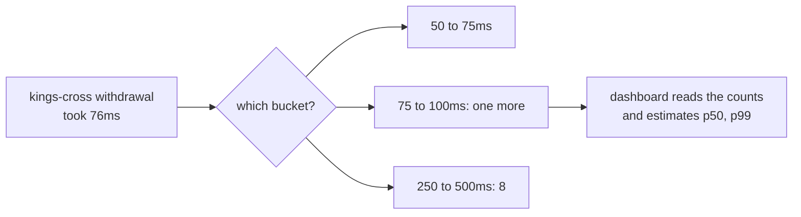

# Part 9: The dashboard

## The scene

So far, someone already knew something was wrong when each part began. In production,
someone has to notice first.

Operations want a dashboard on the wall: how long withdrawals take at each branch, and
how many withdrawals each branch handles, split by outcome. They want a year of history,
and they want the cost to stay flat whether the estate handles two hundred withdrawals a
day or two million. Keeping all your spans for a year fails that last test.

```sh
go run ./workshop/09-the-dashboard/exercise
```

The exercise runs the same 200 withdrawals part 10 will investigate. It sends spans and
wide events, and the Metrics tab in devtools stays empty.

## Predict, before you run it

> A histogram of withdrawal time, split by branch, costs the same at two hundred
> withdrawals a day or two million. What question will it never be able to answer, however
> long you keep it?

## Your turn

Record two things once per withdrawal, whether it succeeded or was refused, so refusals
count too:

1. How long the withdrawal took, split by `atm.branch`.
2. One more withdrawal, split by `atm.branch` and `withdrawal.result`.

`autotel.Meter()` returns a helper with `Histogram` and `Counter` methods, and each takes a
map of labels.

## Our solution

Click **Clear** in devtools, then run:

```sh
go run ./workshop/09-the-dashboard/solution
```

Record as each withdrawal finishes, whatever its outcome:

```go
startedAt := time.Now()
_, err := withdraw(ctx, m, user.CardNumber, amountPence)

outcome := "dispensed"
if err != nil {
	outcome = "refused"
}
meter := autotel.Meter()
meter.Histogram(ctx, "atm.withdraw.duration", float64(time.Since(startedAt).Microseconds())/1000,
	map[string]any{"atm.branch": m.branch})
meter.Counter(ctx, "atm.withdrawals", 1,
	map[string]any{"atm.branch": m.branch, "withdrawal.result": outcome})
```

The recording sits around the call to `withdraw`, in the batch loop, so `withdraw` itself
stays unchanged and both outcomes reach the same two lines. A metric needs no span to record
into, so it does not matter that the span has ended by then. `autotel.Meter()` looks the
provider up on each call and the SDK caches the instrument, so you create nothing up front.
Put the unit in your instrument's name or your docs: this helper takes neither a unit nor a
description, and the `ms` here is a convention. If you want those, or custom buckets, use
`otel.Meter` directly.

Open the **Metrics** tab in devtools and click `atm.withdraw.duration`. The chart shows a bar
per range of durations, for all three branches together, with `p50`, `p90` and `p99` below it.
Under those you see one row per branch. Click a row to see that branch alone. Each branch
holds these counts after the run:

| Branch        | Withdrawals | 50 to 100ms | 250 to 500ms |
| ------------- | ----------- | ----------- | ------------ |
| bridge-street | 80          | 80          | 0            |
| canada-water  | 80          | 72          | 8            |
| kings-cross   | 40          | 32          | 8            |

The dashboard's verdict: bridge-street is fine, one withdrawal in ten at canada-water is slow,
and one in five at kings-cross is. The numbers are correct. Keep that verdict in mind for part
10.

### Why this solution

**A metric is a number you keep updating.** A span is a record: one per withdrawal, with its
facts attached. A metric keeps no records. It holds a few running numbers and throws each
withdrawal away once it has updated them. Its cost stays flat for that reason: two million
withdrawals update the same few numbers as two hundred.

**A counter only goes up.** `meter.Counter(ctx, name, 1, labels)` bumps a running total, the
tally counter at a door from part 3. Add only values of zero or more: something that falls needs
a different instrument. A dashboard turns the total into a rate by comparing it minute to minute:
"40 withdrawals a minute at kings-cross". Use a counter for anything you count: withdrawals,
refusals, retries.

**A histogram keeps counts per range.** A _histogram_ records a spread of values, such as
durations, without keeping them. It splits the number line into ranges, called _buckets_, and
counts how many values land in each. The default bucket edges are 0, 5, 10, 25, 50, 75, 100, 250,
500, 750 and 1,000, then 2,500, 5,000, 7,500 and 10,000, all in milliseconds here. The table above
is the whole of what the histogram stored: bucket counts, plus a total count, a sum, a minimum and
a maximum. The table joins the 50 to 75ms and 75 to 100ms buckets. Typical withdrawals take about
73ms and most land in the first, and a few cross the line into the second, a different few on each
run. Devtools shows the two separately.



**A dashboard's p99 is an estimate from those buckets.** Part 10 explains percentiles in full. For
now, the p99 is the time that 99 withdrawals in 100 beat. The histogram no longer knows any single
withdrawal's time, so the dashboard works it out from the counts. For kings-cross:

1. 99% of 40 withdrawals is 39.6, so the p99 sits at the 39.6th fastest.
2. 32 withdrawals fall below 250ms, and 8 fall between 250 and 500ms, so the 39.6th is in that
   bucket, 7.6 of the way through its 8.
3. Assume the 8 spread evenly across the bucket: 250 plus 7.6/8 of 250 gives 487.5ms.

Click the kings-cross row in devtools and `p99` reads 487.5. Prometheus estimates it the same way,
and so do most dashboards. The slowest real kings-cross withdrawal took about 358ms. The estimate
is off by more than 100ms because the bucket is 250ms wide. You can set narrower buckets when you
create the histogram; the real answer stays a range.

**Labels decide which questions the metric can answer.** A _label_ is an attribute on a metric, such
as `atm.branch`. Each distinct combination of label values becomes its own series, a separate set of
running numbers:

- `atm.withdraw.duration` by branch: 3 series.
- `atm.withdrawals` by branch and result: up to 3 × 2 = 6 series. Devtools shows 3 after this run,
  because the run refuses nobody.
- Add `user.id` as a label: 25 times as many.
- Add `withdrawal.transaction_id`: one series per withdrawal, and the flat cost is gone.

Part 3 warned you about cardinality, and here is the price. Pick labels with a handful of values,
and pick them before the data arrives. The histogram cannot split by a field you did not label, which
answers the Predict question: a metric can never tell you which account, customer or card sat behind
a slow withdrawal.

**Metrics leave on a timer.** Spans leave in batches (part 2). Metrics go out on a schedule: every 60
seconds by default, or the interval you pass to `autotel.WithMetricInterval`, the SDK reads each
instrument and sends its numbers. `autotel.Shutdown` sends a final reading, so a short program still
delivers them.

### When a metric is the right tool

A metric wins when you know the question in advance and need the answer cheaply, for a long time:

- **Machine health.** Memory in use, CPU, goroutine counts and garbage collection pauses, which
  `autotel.WithRuntimeMetrics()` reports for you. A log tells you the process died because it ran out
  of memory. A metric shows memory climbing toward 90% for the hour before, and an alert on it can page
  someone before the crash.
- **Totals and rates over months.** Withdrawals per branch per day, for a year, at a flat cost.
- **Alerts on a known symptom.** Part 7's burn-rate alert counts bad withdrawals against a budget. A
  counter of good and bad withdrawals feeds it for almost nothing.

A metric loses when the question is about the individual withdrawal: which account, which customer,
which combination of fields. Part 5's wide event answers those, and many backends can compute the same
charts from wide events when you ask. You keep both: metrics to notice cheaply, events to explain.

### What the dashboard told you

kings-cross and canada-water look slow. The numbers are true, and they point at two branches. An
engineer reading this dashboard would book visits to two ATM sites. Part 10 starts from this dashboard
and asks what the slow withdrawals have in common.

---

Previous: [Part 8: The questions the business asks](../08-events-the-business-asks-for/README.md) ·
Next: [Part 10: Finding the cause](../10-finding-the-cause/README.md)
