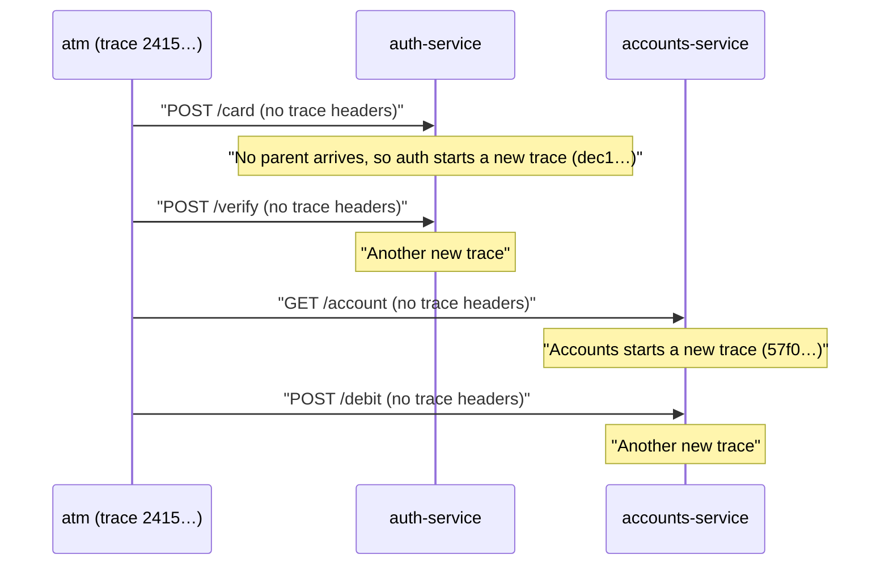
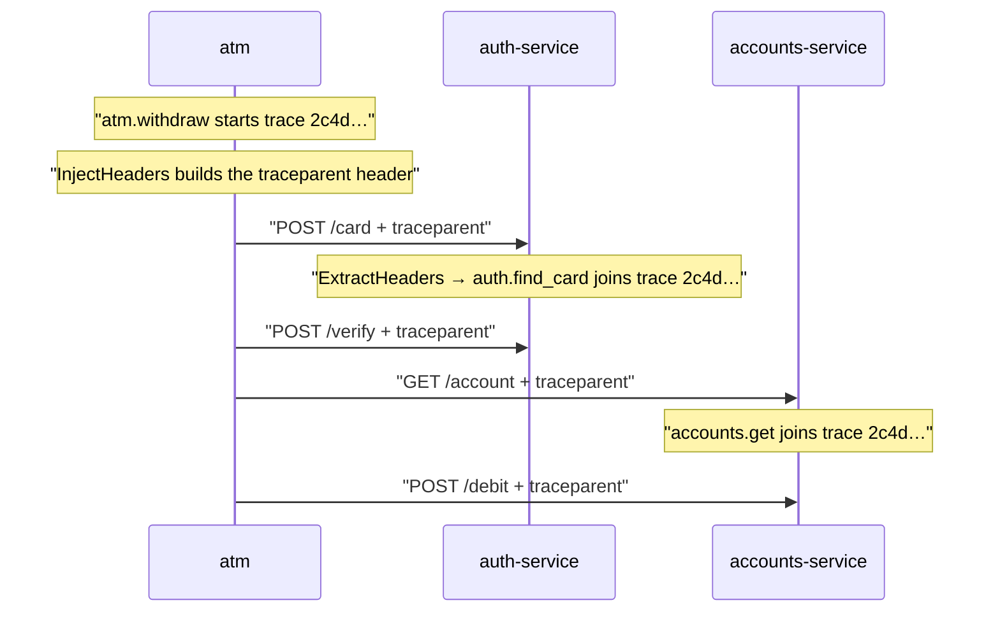
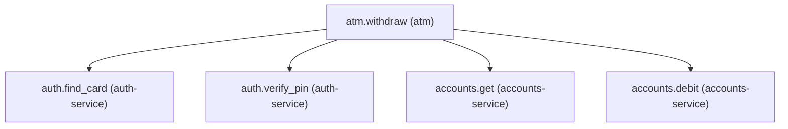
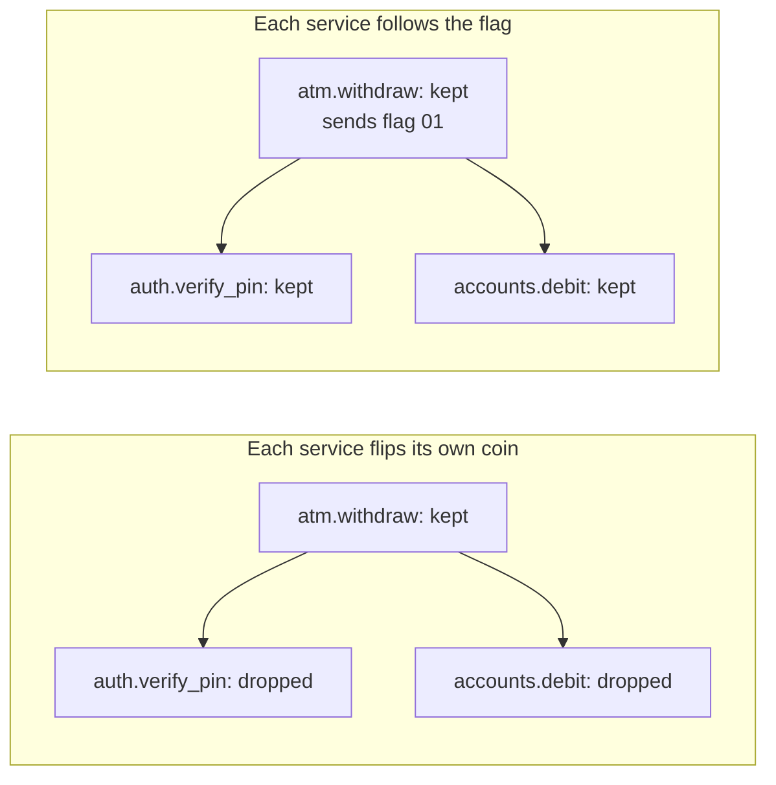

# Part 11: One trace, three services

## The scene

The bank split its one big program, the monolith, into separate services. Auth runs as its own
program now, and so does accounts. The withdrawal makes the same four calls in the same order, with
the instrumentation you wrote in part 5.

Then the first slow withdrawal came in, and part 10's method stopped working.

Click **Clear** in devtools, then run:

```sh
go run ./workshop/11-one-trace-three-services/exercise
```

The command starts three processes: the ATM, `auth-service` on :7101, and `accounts-service` on
:7102. The two services are small `net/http` servers, each its own binary built from `services/`.
Each one calls `autotel.Init` with its own service name and exports to the same devtools.

A **process** is one running program. Inside one process your code shares memory, so your `ctx` can
carry the active span from function to function, the name badge from part 2. A **process boundary**
is the gap between two programs. Think of two offices in different buildings: they share no desk and
no filing cabinet, and each one knows only what arrives in the envelope. Over HTTP, the envelope is
the request.

## Predict, before you run it

> The services are all instrumented. They all export to the same place. They all name themselves.
> What, precisely, is missing?

## What you get

```
[atm]              trace 2415d5403ec764dea48d98e95836b5ee
[auth-service]     trace dec1f07d0ea35c3a3f67bc1616907f11
[accounts-service] trace 57f06174aa56f056e10f003a7dee1314
```

Each process prints a different trace id. Devtools shows more still. The run makes three withdrawals
and the heading reads `Traces (15)`: each of the four calls to a service starts a trace of its own, so
one withdrawal becomes five unrelated one-span traces. You have no path from the slow one to the
reason.



The network split one withdrawal into five records, and none of them knows the others exist.

## Your turn

Make one withdrawal produce one trace.

Two functions in autotel's `middleware` package do the job. Find them, and work out which one belongs
on the caller and which on the receiver. The services live in `services/`, and you may edit them: the
exercise rebuilds them before it starts them, so your change is the one that runs.

## Our solution

Click **Clear** in devtools, then run:

```sh
go run ./workshop/11-one-trace-three-services/solution
```

On the way out, in the ATM:

```go
request := harness.NewRequest(ctx, http.MethodPost, authURL+"/card", map[string]string{"card": cardNumber})
middleware.InjectHeaders(ctx, request)
```

On the way in, in each service, one middleware around the whole mux:

```go
func withCallerContext(next http.Handler) http.Handler {
	return http.HandlerFunc(func(w http.ResponseWriter, r *http.Request) {
		incoming := middleware.ExtractHeaders(r.Context(), r)
		next.ServeHTTP(w, r.WithContext(incoming))
	})
}
```

`services/` and `services-propagated/` differ by that, plus `autotel.WithBaggageAttributes` and
`autotel.WithDebugCapture` in `autotel.Init`, which part 12 uses. See for yourself:

```sh
diff -r workshop/11-one-trace-three-services/services workshop/11-one-trace-three-services/services-propagated
```

```
[atm]              trace 2c4d545da246763446577080ea19d8fa
                   traceparent: 00-2c4d545da246763446577080ea19d8fa-47370c86796d05ee-01
[auth-service]     trace 2c4d545da246763446577080ea19d8fa
[accounts-service] trace 2c4d545da246763446577080ea19d8fa
```



Devtools now lists three traces, one per withdrawal, each with five spans across three services, and
part 10's method works again. Open one. Click a span, and the panel's **Resource** section shows which
service it came from:



The ATM calls `middleware.InjectHeaders` once per request, with the `ctx` that `atm.withdraw` gave it.
That makes all four service spans direct children of `atm.withdraw`.

### Why this solution

**Propagation** means carrying the trace identity from one piece of work to the next, so the next piece
knows which trace it belongs to. _Observability Engineering_ (Chapter 7) names two kinds:

> **Interprocess propagation**: The identity crosses process boundaries, often
> via HTTP headers using W3C TraceContext that include trace ID, parent span ID,
> plus optional baggage (arbitrary key-value pairs) set earlier in a transaction.
>
> **Intraprocess propagation**: The identity flows through methods, threads,
> coroutines, or components inside a process boundary.

You have had intraprocess propagation since part 2. The `ctx` you pass carried the active span, and child
spans nested without you naming their parent. To cross a process boundary, you have to write the identity
into the message.

**One HTTP header carries the missing identity.** It works like a case number at a call centre. When an
agent transfers you, you read the number out, and the next department adds its notes to your case and opens
no new one. **W3C Trace Context** is the standard that defines the header, and the header is called
`traceparent`:

```
traceparent: 00-2c4d545da246763446577080ea19d8fa-47370c86796d05ee-01
```

Hyphens split it into four fields. The ids are written in **hex** (hexadecimal): digits 0 to 9 plus letters
a to f, two characters per byte.

| Field          | Value in this run                  | Meaning                                                                                       |
| -------------- | ---------------------------------- | --------------------------------------------------------------------------------------------- |
| version        | `00`                               | The format version. Services today send `00`.                                                 |
| trace id       | `2c4d545da246763446577080ea19d8fa` | 32 hex characters naming the whole withdrawal. Each service copies it unchanged.              |
| parent span id | `47370c86796d05ee`                 | 16 hex characters naming the span that made the call, here `atm.withdraw`.                    |
| flags          | `01`                               | `01` means the caller is recording this trace, so record yours too. `00` means it dropped it. |

The receiving service creates its own span, gives it the same trace id, and records `47370c86796d05ee` as its
parent. That one step puts `auth.find_card` under `atm.withdraw` in the waterfall. No vendor owns the format,
so a Java, Python or Node service that reads `traceparent` joins your trace without agreeing on anything else.

**The last field carries a sampling decision.** A busy system keeps a fraction of its traces and drops the rest
to control cost. That choice is called **sampling**, and part 12 covers it in depth. In **head-based sampling**,
the service that starts the trace decides, and the book (Chapter 15) describes the next step:

> That decision is then propagated further downstream (e.g., by inserting a
> “guarantee sample retention” header bit) to ensure that every span necessary
> to complete the trace is sampled.

The `01` at the end of `traceparent` is that bit. Picture each service flipping its own coin, keeping 1 trace in
10. The ATM keeps a withdrawal, auth drops its half of the same withdrawal, and accounts keeps its spans for a
different one. You end up with fragments: an `accounts.debit` span with no parent, or an `atm.withdraw` with holes
where its children belong. If each service follows the caller's flag, you keep the whole trace or none of it. The
book calls this **consistent sampling**. OpenTelemetry's default sampler works this way, and so does autotel's,
`ParentBased(AlwaysOn)`: when a request arrives with a `traceparent`, the service copies the caller's decision.



**Inject on the way out, extract on the way in.** To **inject** is to write the active context into an outgoing
message: the case number goes on the envelope. To **extract** is to read it back off an incoming message.

- `middleware.InjectHeaders(ctx, request)` reads the span in `ctx` and writes the headers onto the request.
- `middleware.ExtractHeaders(ctx, request)` reads those headers and returns a new `context.Context`.
  `r.WithContext(incoming)` hands it to the handler, the same way `autotel.Trace` makes a span active for what it
  passes `ctx` to. Each span the service starts from `r.Context()` then finds a parent, even though the parent
  lives in another process. Middleware covers all your routes, including any you add later.

**HTTP is one carrier among many.** A **carrier** is whatever holds the context on its trip. Here it is HTTP headers.
Elsewhere it is a header on a queue message (Kafka, RabbitMQ), gRPC metadata (gRPC's version of headers), or a
`TRACEPARENT` environment variable handed to a child process or CI job. The idea stays the same and the carrier
changes. autotel's two functions speak `*http.Request`, and `otel.GetTextMapPropagator()` takes any carrier directly,
so a queue consumer implements its small `TextMapCarrier` interface over the message's headers. autotel's `messaging`
package does that for you.

A queue changes one thing. The consumer may pick the message up minutes after the publisher finished, so the context
has to live in the message itself. Part 2 met the in-process version of this: a job handed to a background task loses
its badge unless the job carries it. The book (Chapter 7) connects the two with a **span link** in place of a parent. A
link says "this work was caused by that span over there" without claiming that one waited for the other. A consumer
that handles a batch of 50 messages can link to all 50 publishers at once.

**Use HTTP instrumentation in a real service.** `middleware.HTTPMiddleware` extracts for you on the way in and records
a span per request, and `middleware.NewHTTPClient` or `middleware.NewHTTPTransport` injects on the way out. Write the
two calls by hand once anyway, because you will debug a broken trace one day, and the bug takes one of three shapes: the
caller did not inject, the receiver did not extract, or a **proxy** in the middle (a load balancer or gateway that
forwards requests) dropped the header.

**Keep secrets out of the URL.** HTTP instrumentation records the request URL on the span, in attributes such as
`url.full`, so a PIN in a query string would land in your telemetry. The ATM sends the card number and PIN in the POST
body, which auth decodes into its `cardBody` struct. The user id and amount stay in the URL because neither is a secret.

**Decide where `traceparent` goes.** It tells the receiver your trace id. Send it to your own services, and only to a
third party on purpose.

### Check your understanding

Break it on purpose. Remove `middleware.InjectHeaders` from one of the four requests in `solution/main.go`, click
**Clear**, and run it again. Four spans stay in one trace, and the fifth sits alone in a trace of its own, so devtools
lists six traces for the three withdrawals. You will meet a partially propagated system like this far more often than
one with no propagation at all.

> If a run dies halfway, its two services can stay running, and the next run refuses to start with a message such as
> `port 7201 is already in use`. The port depends on the program you ran, and the message gives you the fix, such as
> `lsof -ti tcp:7201 | xargs kill`.

---

Previous: [Part 10: Finding the cause](../10-finding-the-cause/README.md) ·
Next: [Part 12: Facts that travel](../12-facts-that-travel/README.md)
