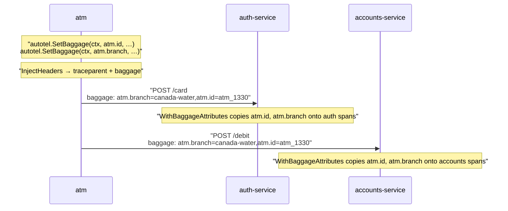
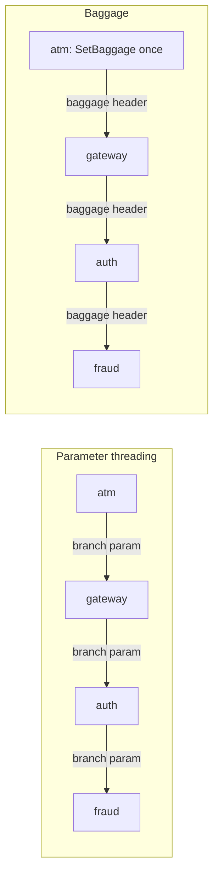
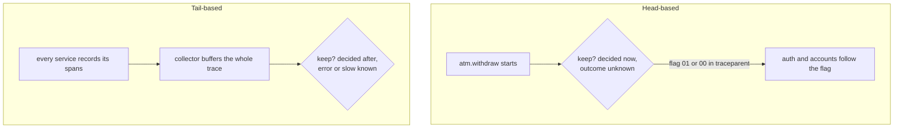

# Part 12: Facts that travel

## The scene

You have one trace across three services, and part 10's method works again. You go back to it: the
accounts service runs slow at one branch and fine at the others, and you want its spans broken down by
branch.

Click **Clear** in devtools, run the exercise, and try this query:

```sh
go run ./workshop/12-facts-that-travel/exercise
```

```
service = accounts-service and atm.branch = "canada-water"
```

The query returns nothing. The accounts service has not heard of a branch. It receives a user id and an
amount, because it needs those two to do its job, and it has no reason to want more.

## Predict, before you run it

> You could add a `branch` parameter to both service calls. Two signatures, ten minutes. What breaks when
> a fourth service arrives next quarter, and who has to change?

## Your turn

Make `atm.id` and `atm.branch` appear on the spans of both services, without adding a parameter to any
function.

You already have most of the mechanism. Part 11's ATM calls `middleware.InjectHeaders`, which writes a
`baggage` header as well as `traceparent` once `ctx` carries any baggage. The services in
`services-propagated/` already pass `autotel.WithBaggageAttributes` to `autotel.Init`. The missing piece
sits in the ATM.

## Our solution

Click **Clear** in devtools, then run:

```sh
go run ./workshop/12-facts-that-travel/solution
```

In the ATM:

```go
ctx, err := autotel.SetBaggage(ctx, "atm.id", m.id)
// ...and "atm.branch" the same way

request := harness.NewRequest(ctx, http.MethodPost, authURL+"/card", body)
middleware.InjectHeaders(ctx, request) // writes traceparent *and* baggage
```

Baggage lives in the context, so `autotel.SetBaggage` returns a new `ctx`. Keep it: send the old one and the
header does not appear. The solution's small `withBaggage` helper sets several keys at once.

In each service, one option on `autotel.Init`:

```go
autotel.Init(ctx,
	autotel.WithService("accounts-service"),
	autotel.WithDevtools(),
	autotel.WithBaggageAttributes(processors.WithBaggagePrefix("")),
)
```

On the wire:

```
traceparent: 00-089c0cef7dc49ebe0de8ab26403c1887-45087e2a0e2ffce6-01
baggage:     atm.id=atm_1330,atm.branch=canada-water
```

The order of entries can change between runs, and means nothing to W3C Baggage: a receiver reads them as a set.



Six withdrawals alternate between two machines, so three of them run at `canada-water`. The query that returned
nothing now returns those three.

### Why this solution

**Baggage** is a set of key-value pairs that travels with a request, in a `baggage` HTTP header defined by W3C
alongside `traceparent`. If `traceparent` is the case number from part 11, baggage is a note stapled to the case
file. Each department that handles the case can read it, and no one has to ask the customer again. `traceparent`
says which trace this is and which span made the call; baggage carries facts you choose.
`middleware.InjectHeaders` writes both headers and `middleware.ExtractHeaders` reads both.

**An attribute stays; baggage travels.** Pick between them on purpose:

|                        | Lives on               | Reaches                                                 |
| ---------------------- | ---------------------- | ------------------------------------------------------- |
| `autotel.SetAttribute` | The span you are in    | Nowhere else                                            |
| `autotel.SetBaggage`   | The `ctx` you get back | Each instrumented downstream service that propagates it |

Baggage on its own lands on no span. It rides along in the request context until a service copies it somewhere.
`autotel.WithBaggageAttributes` tells a service to copy each entry onto each span it creates, at the moment the span
starts. `atm.withdraw` started before `autotel.SetBaggage` ran, so it carries no `atm.branch` itself. Click it in devtools
to check. The default prefix is `baggage.`, so without an option the
field arrives as `baggage.atm.branch`. The prefix keeps a travelling value apart from an attribute the service sets
itself under the same name, and costs you extra typing. This workshop passes `processors.WithBaggagePrefix("")`. Pick
one convention for all services, because you cannot group by a field that two services spell two ways. At a trust
boundary, `processors.WithBaggageAllowlist` copies only the keys you expect.

**Parameter threading makes the middle change.** A `branch` parameter works until a service that has no use for the
branch sits between the ATM and the service that wants it. That service still has to accept the value and pass it on.



With threading, a fourth service means you edit four signatures in four repositories owned by three teams. With
baggage, you set the fact once at the **edge**, the first service a request enters. Each hop passes the header on
untouched, and the new service reads the fact with its own `autotel.Init`.

**Baggage costs bytes and trust.** Each propagated request carries the header to all the services downstream:

- Keep it small: a handful of short keys. Treat it as a label, and keep session state somewhere else.
- Pick keys you will want to filter by. The header's cost is its length in bytes; the cost of many distinct values
  (part 3's cardinality) arrives later, when services copy them onto spans.
- Keep secrets out. The header crosses networks, may show up in proxy logs, and leaves your company if you call a third
  party. A tenant id may fit your policy; a customer's name does not. A collector (defined below) can strip sensitive
  fields before they reach your backend (Chapter 16), but it does not see the header travelling between two services.

### The other thing baggage can carry

```go
ctx, err := autotel.SetBaggage(ctx, autotel.DebugBaggageKey, "part-10")
```

**Sampling** means keeping a fraction of traces and dropping the rest to control volume and cost. A **sampler** is the
component that makes that call. _Observability Engineering_ (Chapter 15) separates samplers by when they decide.

Think of CCTV in a bank. You can decide at the door which customers to film, or film everyone and keep the footage only
for the visits where something went wrong. Samplers make the same two choices.

**Head-based sampling** decides at the door: when the trace starts, at the ATM. The decision travels downstream in the
`traceparent` flag from part 11. It costs little and it decides blind:

> there is no way to know if a downstream service call results in an error at
> the time that a head-sampling decision must be made.

That line comes from Chapter 4. A 10% head sampler keeps one refused withdrawal in ten and drops the other nine, whatever
went wrong in them.

**Tail-based sampling** films everyone and decides afterwards, once the status and duration are known, so it can keep each
error and each slow withdrawal. The catch is storage: something has to hold all the spans from all the services until the
trace ends. The book puts that job outside your code:

> Buffered sampling techniques typically require external collector-side logic.

A **collector** is a separate process that receives telemetry from your services, holds or transforms it, and forwards it to
a backend. Chapter 16 covers collectors as part of a telemetry pipeline.



**What to keep** is a separate choice from when to decide. The book (Chapter 15) lists the options. **Constant probability**
keeps 1 in 10 of everything. **Sampling by content** sets a rate per kind of event: keep each refused withdrawal and 1 in 100
of the dull successful ones. **Sampling by volume** lowers the rate when traffic surges, so a busy Saturday does not flood your
backend.

**Count what each kept trace stands for.** If you keep 1 in 10, each kept withdrawal stands for 10. With mixed rates, weight
each trace by its own rate: keep all refusals and 1 in 10 of the rest, and 6 kept refusals plus 40 kept successes means about
6 + 400 = 406 withdrawals. Record the rate on each event so you can do that sum later. The book (Chapter 15) calls this recording
the sample rate, and it applies to percentiles too: with mixed rates, a p99 over the kept traces alone gives the wrong answer.

Autotel's production sampler, `autotel.WithAdaptiveSampler()`, mixes the approaches. Each process records all its spans, then
decides as each span ends: keep it if it failed or ran past one second, and keep one in ten of the rest. Each service decides on
its own, so the book's warning about late decisions applies:

> At best, you may end up keeping the downstream spans deemed interesting
> outliers, but none of the other context.

Your slow `accounts.debit` survives, and the `atm.withdraw` that would tell you which branch and machine it came from may not.

`autotel.debug` fixes that for one request. Turn it on with `autotel.WithDebugCapture()` in each service's `autotel.Init`. Autotel
then checks for the mark before its keep-or-drop decision and keeps the span when it finds it. The mark rides in baggage, so each
service the request reaches sees it and keeps its spans, and you get the whole trace across all three services. You can set it at a
gateway, from a feature flag, for one customer, or with a single `curl` to your own gateway, and investigate without a deploy:

```sh
curl -H 'baggage: autotel.debug=investigating-9f2c' https://atm.internal/withdraw
```

`atm.internal` stands in for your own address; the workshop does not run this one. The mark overrides autotel's own keep-or-drop
decision. It cannot bring back a trace that a head sampler declined at the ATM, because nothing filmed that trace in the first place,
and it stays inside the rate limiter and circuit breaker. Callers can send this header, so enable it only behind a gateway that sets
or strips the key.

This workshop chooses no sampler, and all your traces reach devtools, so here the query only shows the marking. You see the benefit in
production, where a sampler drops most traces. Try it in devtools:

```
autotel.debug = "part-10"
```

You get one withdrawal of the six, with spans from all three services.

---

Previous: [Part 11: One trace, three services](../11-one-trace-three-services/README.md) ·
Next: [Part 13: A cause in three parts](../13-a-cause-in-three-parts/README.md)
