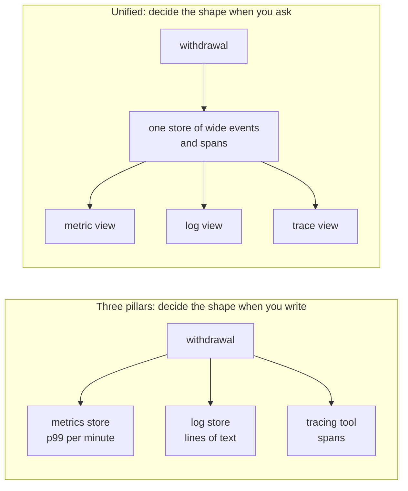
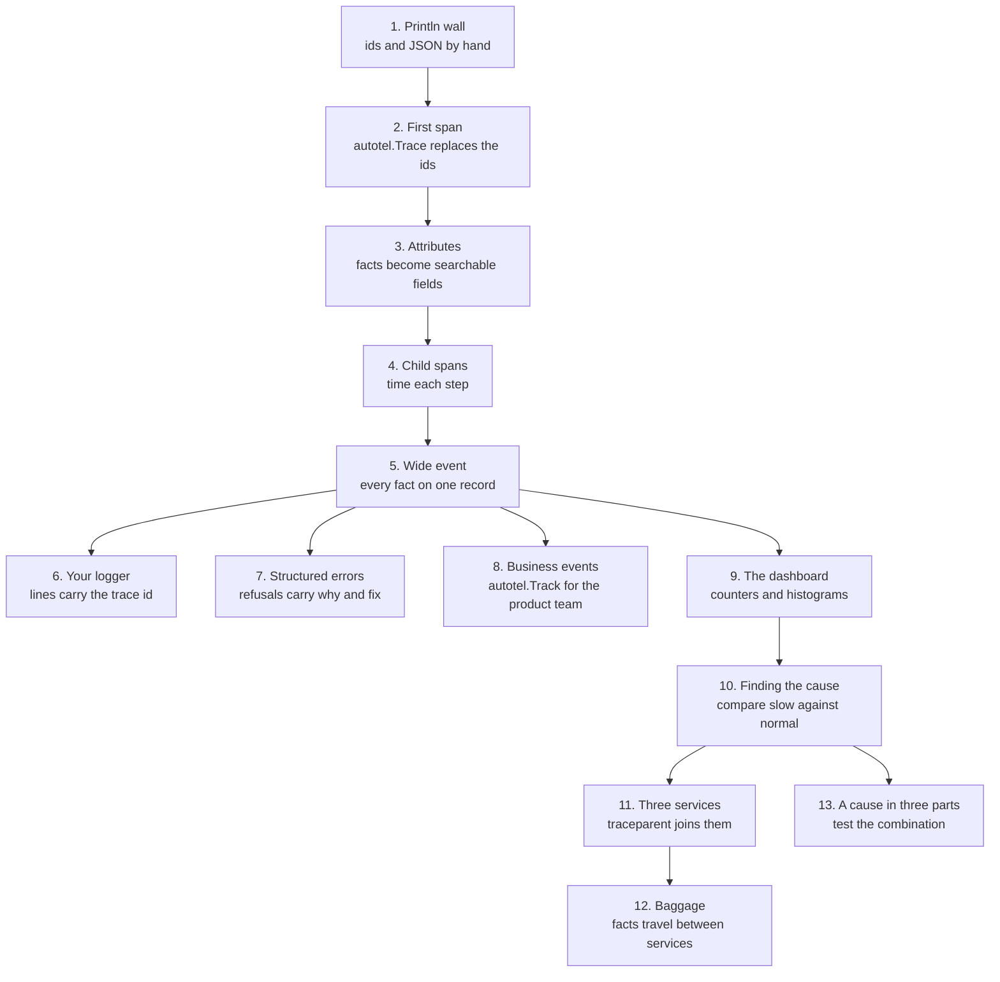
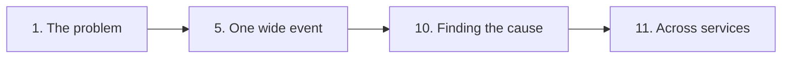

# Go OpenTelemetry Workshop

From `fmt.Println` to one trace across three services, in thirteen parts, with
Go and [autotel](../README.md).

## The scene

A customer calls on a Saturday morning. The machine on Bridge Street took eleven
seconds to give them £40, and they want to know whether the money left their
account twice.

You have the logs. You wrote them.

```
withdrawal started
withdrawal started
withdrawal started
user found: Ada Okafor
user found: Bruno Salas
pin ok
pin ok
```

Five machines were busy at that moment, so five withdrawals wrote into one
stream at once. A `pin ok` line does not say which customer it belongs to, and
no line says how long its step took. Each line is true, and you still cannot
tell which of the four steps took the eleven seconds.

Over thirteen parts you turn that output into a trace that spans three services.
By the end you can pick out one customer's withdrawal and see which operation
took the time. An optional last part finds the withdrawals behind a slowdown
that needs three conditions at once.

## What observability means

The word comes from engineering. In 1960 Rudolf Kálmán asked whether you can
work out what happens inside a machine from what it shows on the outside. If a
fact never reaches any output, you cannot recover it later. The book
_Observability Engineering_ carries the idea into software (Chapter 1):

> The ability to understand or debug any given system state

For you, that means explaining something odd in production from the data your
code already sent, without adding a log line and waiting for it to happen again.

**Monitoring** answers questions you set up in advance: is the machine up, is
the error rate over its threshold. It tells you that something is wrong, and
often where. It cannot tell you why, and it cannot answer a question you did not
configure. The book calls these **known unknowns**: you know the question and
wait for the answer, the way a smoke alarm waits for smoke. **Unknown unknowns**
are problems you did not know to look for. You find them by asking new questions
of data you already recorded (Chapter 3). "Why did one withdrawal on Bridge
Street take eleven seconds?" is one. Your dashboard has no panel for it.

The book's analogy fits this bank. Checking your own balance now and then is
monitoring. Running the bank, where you must trace any transaction between any
two accounts on demand, is observability.

### Instrumentation and OpenTelemetry

**Instrumentation** is code you add so your application reports what it does
as it runs. The book compares it to the traffic sensors and utility meters a
city planner installs (Chapter 4). From a plane at night you see the city's
lights and moving traffic, and you cannot say why a road jams until someone puts
sensors on it. The data those sensors send is **telemetry**.

**OpenTelemetry** (OTel) is an open standard for telemetry: a common format,
plus libraries in each language that produce it. The book calls it a universal
translator (Chapter 4). You write your instrumentation once, and Honeycomb,
Grafana, Datadog or the local devtools in this workshop can all read the data.

OpenTelemetry has three building blocks:

- **Signals** are the data itself: traces, metrics and logs.
- **Context** ties the signals together. It records which request and which
  step produced each piece of data, so a log line and a span from one withdrawal
  carry the same trace ID.
- **Semantic conventions** are shared names. `http.request.method` means the
  same thing in your code, in your cloud provider's data and in the tools that
  read either.

OpenTelemetry produces and sends the data. It stores nothing and draws no
charts. A **backend** does that part: Honeycomb, Grafana, Datadog, Better Stack
or SigNoz. In this workshop, devtools plays the backend.

### Three views of one withdrawal

Most teams store each kind of telemetry in its own tool: **metrics** (numbers
over time) in one database, **logs** in a log store, **traces** in a tracing
tool. The book calls this the three pillars model. Each pillar sees a different
slice of the eleven-second withdrawal:

| Signal     | What it records                                          | What it tells you about Bridge Street                                                |
| ---------- | -------------------------------------------------------- | ------------------------------------------------------------------------------------ |
| **Metric** | One number summarising many withdrawals, such as p99 (the time 99 in 100 beat) | Withdrawal latency went up. It cannot say for which customer or in which step.       |
| **Log**    | One line per thing that happened                         | Each step happened. You rebuild the timeline yourself from interleaved timestamps.   |
| **Trace**  | Timed, nested spans for one request                      | The four steps of this one withdrawal and how long each took.                        |

Each signal has a job it does best. Take a process that dies because it ran out
of memory. The log line says it died, and why. A metric of memory in use shows it
climbing toward 90% for the hour before, and an alert on that metric could have
paged someone before the crash. A trace shows which request was running when
memory ran out, and where that request spent its time. Part 9 shows where a
metric is the better tool.

This workshop takes the other approach the book describes, the **unified
model**. You keep one detailed record per withdrawal with all its facts attached,
and build the chart, the log line or the trace from those records when you ask
the question:



Aggregation runs one way, like a blender: you can turn fruit into a smoothie,
and you cannot turn the smoothie back into fruit. A metric store keeps the p99
and throws away the withdrawals it came from, so you cannot split that p99 by
branch or by customer later. A store of raw events can compute the p99 today and
split it by any field tomorrow, including a field you discover in part 10.

## Who this is for

You have shipped Go and you debug it with `fmt.Println`. You may have opened the
OpenTelemetry documentation and found it assumed too much. You do not need to
know what a span, OTLP or a collector is. Each part defines the terms its
exercise needs, and the [Terms](#terms) table below collects them. You should be
comfortable with goroutines and `context.Context`.

Plan for half a day. You need Go 1.26 or newer, and Node 22 or newer to run
devtools, the local receiver. You need no hosted account and no Docker.

## Setup

From the repository root:

```sh
go version                     # 1.26 or newer
node --version                 # 22 or newer, for devtools only
go build ./workshop/...        # compile once up front
npx autotel-devtools           # leave this running in its own terminal
```

`npx autotel-devtools` starts a small local server that receives the telemetry
your code sends, with a web UI to browse it. It prints a banner with its address,
normally `http://127.0.0.1:4318`. Open that address in a browser and keep the tab
open for the whole workshop. From part 2 onward you read that tab, in place of
stdout, to see what your code did.

> If something else holds port 4318, devtools moves to the next free port and
> the banner shows it, such as `Listening: 127.0.0.1:4319`. Your code still sends
> to 4318, so tell it where devtools went. Run this in the terminal where you run
> the Go code, and in any new terminal you open for that purpose:
>
> ```sh
> export OTEL_EXPORTER_OTLP_ENDPOINT=http://127.0.0.1:4319
> ```

Then, in a second terminal, still at the repository root:

```sh
go run ./workshop/01-the-console-log-wall/exercise   # run part 1's exercise
go run ./workshop/01-the-console-log-wall/solution   # run our solution to part 1
```

Each part runs to completion and exits, so your loop is edit, run, look at the
trace.

If a run ends with `autotel: telemetry not delivered`, your code tried to send
its data and nothing answered. Either devtools has stopped, or it listens on a
port other than the one your code sends to. Start it, or set
`OTEL_EXPORTER_OTLP_ENDPOINT` to match its banner.

## Reading devtools

You need five things from the devtools tab:

- **Clear** (top right) empties devtools. Click it before you run a program.
  Devtools keeps what earlier runs sent, so the counts in these READMEs only match
  a run on its own.
- **The search box** sits at the top of the Traces tab. Type a query and the
  results update as you type. The heading shows the count: `Traces (6 of 9)` means
  six traces matched, out of nine in the tab. Conditions in one query
  must hold on the same span, and the list shows the whole trace that span belongs
  to, one row per trace.
- **A trace** opens when you click its row. You get the **waterfall**: one bar per
  span, placed by start time, as long as its duration, and indented under its
  parent.
- **A span** opens when you click its name in the waterfall. A panel on the right
  shows its status and all its fields under **Attributes**. A filter box there
  finds a field by name.
- **The status badge** on a trace reads `OK` unless a span in it failed. It reads
  `OK` even when you never set a status yourself.

Devtools filters and has no group-by. To split a set of traces by a field, add one
value of that field to your query and read the count, then try the next value.

## How each part goes

1. **A scene.** Something has gone wrong, or someone has asked a question your
   current data cannot answer.
2. **Predict.** Each part asks you a question first. Write your answer somewhere
   you cannot edit later. You learn the most from this step, so do not skip it.
3. **Your turn.** `exercise/main.go` compiles and runs as it is, and lacks one
   idea. You add it.
4. **Our solution.** `solution/main.go` runs too, and the part's README explains
   the shape we chose and what it costs.

You get no failing test suite. You check your work by looking at the trace in
the devtools tab, the same feedback you will have at work.

## The thirteen parts

| #                                                | You will                                                     | Predict before you start                                                                                   |
| ------------------------------------------------ | ------------------------------------------------------------ | ---------------------------------------------------------------------------------------------------------- |
| [1](01-the-console-log-wall/README.md)           | Watch five concurrent withdrawals scramble a log             | How would you find out how long one customer's withdrawal took?                                            |
| [2](02-your-first-span/README.md)                | Replace hand-rolled ids and timers with one wrapper          | Five concurrent calls, nothing passed between them. How does each call know it is not the first?          |
| [3](03-attributes-not-messages/README.md)        | Move the facts out of strings and onto the span              | `atm.model` has two values, `transaction_id` has millions. Which is worth recording?                       |
| [4](04-which-work-deserves-a-span/README.md)     | Decide which of six operations get their own span            | Which of the six earn a span, and which do not?                                                            |
| [5](05-one-wide-event/README.md)                 | Gather every fact of a withdrawal onto one record            | Each fact already sits on one of five spans. What do you gain by gathering them all onto the root span?    |
| [6](06-logs-you-already-have/README.md)          | Keep your logger and stamp every line with its trace id      | `autotel.Init` runs at the top of `main`. Why do the log lines still have no trace id?                  |
| [7](07-errors-that-explain-themselves/README.md) | Make six refusals say what to do next                        | Three audiences for one failure. Three error types, or one?                                                |
| [8](08-events-the-business-asks-for/README.md)   | Answer a product question without a devtools tab             | Your spans hold the numbers already. What is left for a separate event to do?                              |
| [9](09-the-dashboard/README.md)                  | Build the dashboard: a counter and a histogram per branch    | A histogram costs the same at any traffic. What question can it never answer?                              |
| [10](10-finding-the-cause/README.md)             | Find why 16 withdrawals of 200 are slow                      | p50 flat, p99 quadrupled. All customers a little, or a few a lot?                                          |
| [11](11-one-trace-three-services/README.md)      | Put one trace back together across three processes           | Every service is instrumented and exports to the same place. What is missing?                              |
| [12](12-facts-that-travel/README.md)             | Carry a fact to a service that never asked for it            | You could add a parameter. What breaks when the fourth service arrives?                                    |
| [13](13-a-cause-in-three-parts/README.md)        | Optional, advanced, ~30 min: a canary slowdown in a 3-way cohort | Four labels each point at a slow value. One cause, all of them, or a combination?                     |

Each part keeps what the previous one built and adds one idea:



## If you only have ninety minutes

Do parts 1, 5, 10 and 11. Part 1 shows the problem and part 5 shows the shape
of the answer. In part 10 you find a cause from the data, and part 11 carries the
method across services.



Part 4 works best with a colleague to argue with, so save it for later.

Part 13 is optional. For a session about investigation, run it straight after
part 10.

## What is in here

```
bank/          the domain: users, cards, accounts, a ledger (the `bank` package)
NN-name/       one part: README.md, exercise/main.go, solution/main.go
               (part 6 adds instrumentation.go, part 11 a harness and two services,
               part 13 a dispenser package)
check/         runs each part against a fake OTLP receiver
```

`bank/` does not use autotel, and you do not change it. It stays the same across
all thirteen parts while the observability varies, so when part 7 looks different
from part 5, the difference is the lesson. Its data comes from a seeded generator,
so the balances and counts in these READMEs match on your machine. Durations vary
by a few milliseconds.

The PIN attempt counter survives between requests. A customer can lose their card
because of something that happened in an earlier withdrawal, and no function
signature mentions it.

## Terms

| Term                          | Meaning here                                                                                                                                               |
| ----------------------------- | ---------------------------------------------------------------------------------------------------------------------------------------------------------- |
| **Observability**             | Your ability to understand or debug any state your system gets into, including states you never predicted, from the data it emits.                        |
| **Instrumentation**           | Code you add so your application emits data about what it does as it runs. Parts 1 and 2.                                                                 |
| **Telemetry**                 | The data instrumentation sends out: spans, logs, metrics and events.                                                                                      |
| **OpenTelemetry (OTel)**      | An open standard for telemetry, plus libraries that produce it, so any vendor's tool can read your data.                                                  |
| **Unit of work**              | One thing your system does that you want a record of. Here, one withdrawal. Part 1.                                                                       |
| **Structured event**          | A record of one unit of work as key-value pairs a machine can parse, such as a JSON log line. Part 1.                                                     |
| **Signal**                    | One of OpenTelemetry's three kinds of data: traces, metrics and logs.                                                                                      |
| **Backend**                   | The tool that stores telemetry and lets you query it, such as Honeycomb or Grafana. Devtools plays it here.                                               |
| **Metric**                    | A number kept up to date across many requests, such as requests per minute or p99 latency. The individual requests are gone. Part 9.                      |
| **Counter / histogram**       | Two kinds of metric. A counter only goes up. A histogram counts how many values land in each range, called a bucket. Part 9.                              |
| **Log correlation**           | Stamping each log line with the trace ID and span ID of the request that wrote it. Part 6.                                                                |
| **Span**                      | One timed operation: a name, a start time, a duration, a status and key-value fields. Part 2.                                                              |
| **Trace**                     | The tree of spans that one request produced. All its spans share a trace ID. Part 2.                                                                       |
| **Attribute**                 | A key-value field on a span, such as `user.id = "u_007"`. You filter and group by attributes. Part 3.                                                      |
| **Cardinality**               | The number of distinct values a field can take. `atm.model` has two; `withdrawal.transaction_id` has one per withdrawal. Part 3.                            |
| **Context**                   | The record of which span is running right now: its trace ID and span ID. It travels in the `context.Context` you pass down, so five withdrawals can run at once. Parts 2 and 11. |
| **Wide event**                | One record per unit of work holding every fact that unit knew. Also called a canonical log line. Part 5.                                                   |
| **Business event**            | A record of something a customer did, named for the product team (`atm.cash_withdrawn`) and sent to an analytics tool. Part 8.                             |
| **p50 / p99**                 | Percentiles of duration. Half of requests finish faster than p50; 99 in 100 finish faster than p99. Part 10.                                                |
| **W3C `traceparent`**         | The HTTP header that carries a trace ID and parent span ID from one service to the next, defined by the W3C Trace Context standard. Part 11.                 |
| **Baggage**                   | Key-value pairs that travel with a request to every downstream service in the `baggage` header. Part 12.                                                   |
| **Collector**                 | A relay between your services and a backend. It receives telemetry, processes it, and forwards it on. See below.                                          |

## Taking this to work

The workshop runs on your laptop against devtools. A real service needs five
changes, most of them small.

1. **Set telemetry up first, in one place.** Call `autotel.Init` at the top of
   `main`, then install your logger with autotel's handler in it. Part 6 shows
   why: `Init` never touches a logger you built yourself.
2. **Use the instrumentation your libraries already offer.** `otelhttp` and
   `otelgrpc` record HTTP and gRPC calls, and autotel's `middleware` package wraps
   them along with Gin, Chi and Echo. Those spans join the traces `autotel.Trace`
   creates through the `context.Context`, so keep passing it down.
3. **Keep your logger.** Wrap your `slog` handler with
   `logging.NewTraceHandler` and log through the `*Context` methods, so every line
   leaves with a trace ID (part 6).
4. **Send to a backend, usually through a collector.** Point
   `OTEL_EXPORTER_OTLP_ENDPOINT` at your backend or at an OpenTelemetry
   Collector. A collector sits between your services and the backend:

   ```mermaid
   flowchart LR
     S1["atm"] --> R
     S2["auth-service"] --> R
     S3["accounts-service"] --> R
     subgraph C["OpenTelemetry Collector"]
       R["receivers<br/>accept OTLP"] --> P["processors<br/>batch, filter,<br/>redact, sample"]
       P --> X["exporters<br/>send on"]
     end
     X --> B1["your backend"]
     X --> B2["a second backend"]
   ```

   With a collector, your services send to one address, and the team that runs
   the collector chooses backends, strips secrets and decides what to keep.
5. **Sample.** At real traffic you keep a share of your traces. Part 12 explains
   how to choose which ones, and how to count what you kept.
   `autotel.WithAdaptiveSampler()` keeps errors, slow traces and a baseline share
   in each process. When one request crosses services, sample in the collector
   too, so one decision covers the spans from all of them.

If an AI assistant writes your instrumentation, review its work the way you would
review a junior engineer's pull request. It handles the boilerplate well: wrapping
functions in `autotel.Trace` and filling in standard attribute names. It cannot
know that `account.shard` is the field your next incident turns on. Check each
name against part 3's conventions, and each span against part 4's rules.

### What this workshop leaves out

The same model, wide events joined by context, reaches beyond backend services.
These topics fall outside this workshop:

- **SLOs in a real backend.** Most backends can store the SLI, track the error
  budget and fire burn alerts (Chapters 11 and 12).
- **CI pipelines.** Treat each pipeline run as a trace and each job and step
  as a span. OpenTelemetry's `cicd.*` conventions name the fields, and the
  `TRACEPARENT` variable from part 11 joins the steps (Chapter 18).
- **Browsers and mobile apps.** A session id carried from the device through
  every backend call (Chapter 19).
- **LLM calls.** One span for each model call, with token counts under the
  `gen_ai.*` conventions, and an eval score recorded as an attribute
  (Chapter 21).

## Where this came from

The arguments in these READMEs come from _Observability Engineering_, second
edition, by Charity Majors, Liz Fong-Jones, George Miranda and Austin Parker
(O'Reilly). Quotes from the book appear as block quotes. The book supplies the
reasoning, and this workshop turns it into code you can break.

The library is autotel-go, the module at the root of this repository, which
produces OpenTelemetry data. To send what you write here to Honeycomb, Grafana,
Datadog, SigNoz or an OpenTelemetry Collector, set `OTEL_EXPORTER_OTLP_ENDPOINT`
(or use `autotel.WithEndpoint`). Your code stays the same, so learn the model
before any vendor's UI.

This workshop is the Go port of the one in
[autotel-rust](https://github.com/jagreehal/autotel-rust).

## Checks

```sh
go run ./workshop/check        # every part
go run ./workshop/check 07     # one part
```

The command builds each part and runs its exercise and solution against a fake
OTLP receiver (OTLP is the wire format, defined in part 2). It decodes what
arrives and compares it with the `// check` lines at the top of each
`solution/main.go`: spans, counts, parent and child, one trace across services,
metrics, log records and printed output. Exercises only have to run. Use this
command after a library upgrade to catch a broken part. Run it from the repository
root.
